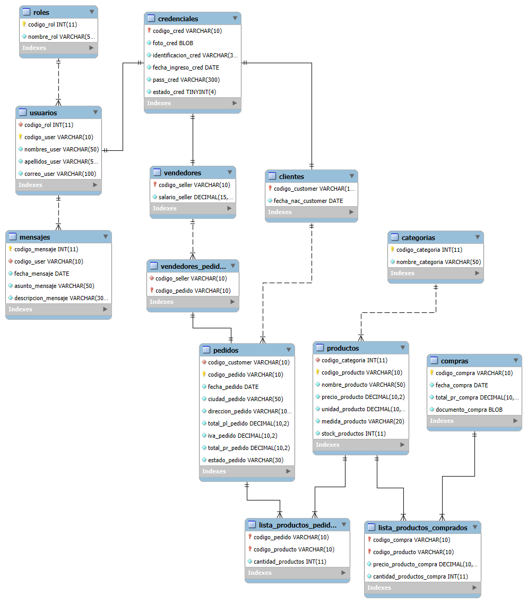

# Paso 1: Primera Forma Normal (1FN)

## 📚 Explicación

La **Primera Forma Normal (1FN)** establece que una tabla está en 1FN si y solo si cumple **tres condiciones**:

1. **Todos los atributos son atómicos**: cada celda contiene un único valor indivisible. No se permiten listas, arreglos, conjuntos, ni valores compuestos en una misma columna.
2. **No hay grupos repetidos**: no pueden existir columnas que representen el mismo tipo de dato repetido (ej. `telefono1`, `telefono2`, `telefono3`).
3. **Cada fila es única**: debe existir una **clave primaria** que identifique de manera única a cada registro (puede ser simple o compuesta).

Además, cada columna debe almacenar **un solo tipo de dato** y tener un **nombre único** dentro de la tabla.

> ⚠️ Nota importante: Aunque el script usa `BLOB` para `foto_cred` y `documento_compra`, técnicamente un BLOB almacena un archivo binario (un solo valor), por lo que **no viola 1FN**. Sin embargo, en un análisis posterior (Paso 4) sugeriré almacenar rutas de archivo en lugar del binario dentro de la BD.

---

## 🔍 Análisis del script recibido frente a 1FN

Voy a revisar tabla por tabla.

| Tabla | ¿Cumple 1FN? | Observación |
|---|---|---|
| `ROLES` | ✅ Sí | Atributos atómicos, PK definida. |
| `USUARIOS` | ✅ Sí | Atributos atómicos, PK `codigo_user`. |
| `CREDENCIALES` | ✅ Sí | Atributos atómicos (BLOB es un solo valor), PK definida. |
| `MENSAJES` | ⚠️ **Parcial** | Atributos atómicos, **pero no tiene clave primaria**. Esto ya es un problema de unicidad de fila exigida por 1FN. |
| `CATEGORIAS` | ✅ Sí | Atributos atómicos, PK definida. |
| `PRODUCTOS` | ✅ Sí | Atributos atómicos, PK definida. |
| `CLIENTES` | ✅ Sí | Atributos atómicos, PK definida. |
| `PEDIDOS` | ✅ Sí | Atributos atómicos, PK definida. |
| `LISTA_PRODUCTOS_PEDIDOS` | ⚠️ **No** | No tiene PK. Cada fila representa la relación entre un pedido y un producto, pero nada garantiza unicidad. Se requiere **PK compuesta** `(codigo_pedido, codigo_producto)`. |
| `VENDEDORES` | ✅ Sí | Atributos atómicos, PK definida. |
| `VENDEDORES_PEDIDOS` | ⚠️ **No** | La PK es solo `codigo_pedido`, por lo que un pedido no puede tener más de un vendedor asignado (esto podría ser intencional, pero la tabla está modelando una relación N:M — ver análisis). |
| `COMPRAS` | ✅ Sí | Atributos atómicos, PK definida. |
| `LISTA_PRODUCTOS_COMPRADOS` | ⚠️ **No** | No tiene PK. Requiere **PK compuesta** `(codigo_compra, codigo_producto)`. Además, `codigo_producto VARCHAR(45)` no coincide con el `VARCHAR(10)` de `PRODUCTOS`, lo cual **rompe la FK** (error de implementación). |

---

## 🛠️ Solución de problemas detectados

### ❌ Problema 1: `MENSAJES` sin clave primaria

La tabla `MENSAJES` no tiene PK, por lo que no se garantiza unicidad de filas. Se debe agregar un identificador propio al mensaje.

**Solución:** Agregar una columna `codigo_mensaje INT AUTO_INCREMENT` como PK.

### ❌ Problema 2: `LISTA_PRODUCTOS_PEDIDOS` sin clave primaria

Esta tabla representa la relación N:M entre `PEDIDOS` y `PRODUCTOS`. Sin PK, pueden existir duplicados (mismo pedido con el mismo producto en varias filas), lo que además rompe la lógica de negocio (la cantidad debe agruparse en una sola fila por producto).

**Solución:** Definir **clave primaria compuesta** `(codigo_pedido, codigo_producto)`.

### ❌ Problema 3: `LISTA_PRODUCTOS_COMPRADOS` sin clave primaria y con inconsistencia de tipo en la FK

- No tiene PK.
- `codigo_producto VARCHAR(45)` no coincide con `PRODUCTOS.codigo_producto VARCHAR(10)`. **MySQL no permite crear una FK si los tipos no coinciden** (error 3780 / 1005). Por lo tanto, **este script falla al ejecutarse** en este punto.

**Solución:** 
- Cambiar `codigo_producto` a `VARCHAR(10)`.
- Definir **PK compuesta** `(codigo_compra, codigo_producto)`.

### ⚠️ Problema 4 (advertencia): `VENDEDORES_PEDIDOS` con PK solo en `codigo_pedido`

La PK actual es `codigo_pedido`, lo que implica que **un pedido solo puede tener un vendedor** (relación 1:N desde pedido hacia vendedor). Según el contexto ("los vendedores se ganan una comisión cada vez que ayudan a una venta en el local"), un pedido físico podría tener varios vendedores asociados. 

Sin embargo, **esto no es estrictamente un problema de 1FN**, sino de modelado (cardinalidad). Lo dejaré anotado y lo resolveré con mayor profundidad en el **Paso 4 (mejoras)**, donde además revisaremos los pedidos en línea que no deberían tener vendedor.

### ⚠️ Problema 5 (advertencia): `CREDENCIALES.codigo_cred` como FK de `USUARIOS`

El diseño actual hace que `CREDENCIALES` sea una subtabla de `USUARIOS`, y a su vez `CLIENTES` y `VENDEDORES` son subtablas de `CREDENCIALES`. Esta cadena es correcta en 1FN (atributos atómicos y PKs definidas), pero genera **dependencias transitivas** que analizaremos en **3FN**.

### ⚠️ Problema 6 (advertencia): Restricciones `CHECK` con `LIKE`

```sql
CHECK (codigo_cred NOT LIKE '%person%')
CHECK (codigo_customer LIKE '%customer%')
CHECK (codigo_seller LIKE '%seller%')
```

Estas restricciones **no son un problema de 1FN**, pero son **frágiles**: dependen del contenido del string del código. En el Paso 4 sugeriré reemplazarlas por un atributo `tipo_usuario` o por una jerarquía basada en `ROLES`.

> En MySQL, los `CHECK` solo se aplican a partir de la versión 8.0.16. Si usas una versión anterior, **se ignoran silenciosamente**.

---

## ✅ Código completo corregido (1FN)

A continuación, el script completo con las correcciones de 1FN aplicadas. Los cambios están **comentados con `-- [1FN]`** para que los identifiques fácilmente.

```sql
DROP DATABASE IF EXISTS BBDD_INVENTARIO;
-- -----------------------------------------------------
-- Estructura BBDD_INVENTARIO - VERSIÓN 1FN
-- -----------------------------------------------------
CREATE SCHEMA BBDD_INVENTARIO DEFAULT CHARACTER SET utf8;
USE BBDD_INVENTARIO;

-- -----------------------------------------------------
-- Tabla ROLES
-- -----------------------------------------------------
CREATE TABLE ROLES (
  codigo_rol INT NOT NULL AUTO_INCREMENT,
  nombre_rol VARCHAR(50) NOT NULL,
  PRIMARY KEY (codigo_rol)
) ENGINE = InnoDB;

-- -----------------------------------------------------
-- Tabla USUARIOS
-- -----------------------------------------------------
CREATE TABLE USUARIOS (
  codigo_rol INT NOT NULL,
  codigo_user VARCHAR(10) NOT NULL,
  nombres_user VARCHAR(50) NOT NULL,
  apellidos_user VARCHAR(50) NOT NULL,
  correo_user VARCHAR(100) NOT NULL,
  PRIMARY KEY (codigo_user),
  INDEX ind_usuario_rol (codigo_rol ASC),
  UNIQUE INDEX uq_correo_user (correo_user ASC),
  CONSTRAINT fk_usuario_rol
    FOREIGN KEY (codigo_rol)
    REFERENCES ROLES (codigo_rol)
    ON DELETE CASCADE
    ON UPDATE CASCADE
) ENGINE = InnoDB;

-- -----------------------------------------------------
-- Tabla CREDENCIALES
-- -----------------------------------------------------
CREATE TABLE CREDENCIALES (
  codigo_cred VARCHAR(10) NOT NULL,
  foto_cred BLOB NOT NULL,
  identificacion_cred VARCHAR(30) NOT NULL,
  fecha_ingreso_cred DATE NOT NULL,
  pass_cred VARCHAR(300) NOT NULL,
  estado_cred TINYINT NOT NULL,
  PRIMARY KEY (codigo_cred),
  UNIQUE INDEX uq_identificacion_cred (identificacion_cred ASC),
  CONSTRAINT chk_evitarPersona
    CHECK (codigo_cred NOT LIKE '%person%'),
  CONSTRAINT fk_credencial_usuario
    FOREIGN KEY (codigo_cred)
    REFERENCES USUARIOS (codigo_user)
    ON DELETE CASCADE
    ON UPDATE CASCADE
) ENGINE = InnoDB;

-- -----------------------------------------------------
-- Tabla MENSAJES  -- [1FN] Se agrega PK codigo_mensaje
-- -----------------------------------------------------
CREATE TABLE MENSAJES (
  codigo_mensaje INT NOT NULL AUTO_INCREMENT,        -- [1FN] NUEVA PK
  codigo_user VARCHAR(10) NOT NULL,
  fecha_mensaje DATE NOT NULL,
  asunto_mensaje VARCHAR(50) NOT NULL,
  descripcion_mensaje VARCHAR(300) NOT NULL,
  PRIMARY KEY (codigo_mensaje),                       -- [1FN] PK agregada
  INDEX ind_mensaje_usuario (codigo_user ASC),
  CONSTRAINT fk_mensaje_usuario
    FOREIGN KEY (codigo_user)
    REFERENCES USUARIOS (codigo_user)
    ON DELETE CASCADE
    ON UPDATE CASCADE
) ENGINE = InnoDB;

-- -----------------------------------------------------
-- Tabla CATEGORIAS
-- -----------------------------------------------------
CREATE TABLE CATEGORIAS (
  codigo_categoria INT NOT NULL AUTO_INCREMENT,
  nombre_categoria VARCHAR(50) NOT NULL,
  PRIMARY KEY (codigo_categoria)
) ENGINE = InnoDB;

-- -----------------------------------------------------
-- Tabla PRODUCTOS
-- -----------------------------------------------------
CREATE TABLE PRODUCTOS (
  codigo_categoria INT NOT NULL,
  codigo_producto VARCHAR(10) NOT NULL,
  nombre_producto VARCHAR(50) NOT NULL,
  precio_producto DECIMAL(10,2) NOT NULL,
  unidad_producto DECIMAL(10,2) NOT NULL,
  medida_producto VARCHAR(20) NOT NULL,
  stock_productos INT NOT NULL,
  PRIMARY KEY (codigo_producto),
  INDEX ind_producto_categoria (codigo_categoria ASC),
  CONSTRAINT fk_producto_categoria
    FOREIGN KEY (codigo_categoria)
    REFERENCES CATEGORIAS (codigo_categoria)
    ON DELETE CASCADE
    ON UPDATE CASCADE
) ENGINE = InnoDB;

-- -----------------------------------------------------
-- Tabla CLIENTES
-- -----------------------------------------------------
CREATE TABLE CLIENTES (
  codigo_customer VARCHAR(10) NOT NULL,
  fecha_nac_customer DATE NOT NULL,
  PRIMARY KEY (codigo_customer),
  CONSTRAINT chk_soloCliente
    CHECK (codigo_customer LIKE '%customer%'),
  CONSTRAINT fk_cliente_credencial
    FOREIGN KEY (codigo_customer)
    REFERENCES CREDENCIALES (codigo_cred)
    ON DELETE CASCADE
    ON UPDATE CASCADE
) ENGINE = InnoDB;

-- -----------------------------------------------------
-- Tabla PEDIDOS
-- -----------------------------------------------------
CREATE TABLE PEDIDOS (
  codigo_customer VARCHAR(10) NOT NULL,
  codigo_pedido VARCHAR(10) NOT NULL,
  fecha_pedido DATE NOT NULL,
  ciudad_pedido VARCHAR(50) NOT NULL,
  direccion_pedido VARCHAR(100) NOT NULL,
  total_pl_pedido DECIMAL(10,2) NOT NULL,
  iva_pedido DECIMAL(10,2) NOT NULL,
  total_pr_pedido DECIMAL(10,2) NOT NULL,
  estado_pedido VARCHAR(30) NOT NULL,
  PRIMARY KEY (codigo_pedido),
  INDEX ind_pedido_cliente (codigo_customer ASC),
  CONSTRAINT fk_pedido_cliente
    FOREIGN KEY (codigo_customer)
    REFERENCES CLIENTES (codigo_customer)
    ON DELETE CASCADE
    ON UPDATE CASCADE
) ENGINE = InnoDB;

-- -----------------------------------------------------
-- Tabla LISTA_PRODUCTOS_PEDIDOS  -- [1FN] PK compuesta
-- -----------------------------------------------------
CREATE TABLE LISTA_PRODUCTOS_PEDIDOS (
  codigo_pedido VARCHAR(10) NOT NULL,
  codigo_producto VARCHAR(10) NOT NULL,
  cantidad_productos INT NOT NULL,
  PRIMARY KEY (codigo_pedido, codigo_producto),       -- [1FN] PK compuesta
  INDEX ind_lista_producto_producto (codigo_producto ASC),
  CONSTRAINT fk_lista_productos_pedido
    FOREIGN KEY (codigo_pedido)
    REFERENCES PEDIDOS (codigo_pedido)
    ON DELETE CASCADE
    ON UPDATE CASCADE,
  CONSTRAINT fk_lista_productos_producto
    FOREIGN KEY (codigo_producto)
    REFERENCES PRODUCTOS (codigo_producto)
    ON DELETE CASCADE
    ON UPDATE CASCADE
) ENGINE = InnoDB;

-- -----------------------------------------------------
-- Tabla VENDEDORES
-- -----------------------------------------------------
CREATE TABLE VENDEDORES (
  codigo_seller VARCHAR(10) NOT NULL,
  salario_seller DECIMAL(15,2) NOT NULL,
  PRIMARY KEY (codigo_seller),
  CONSTRAINT chk_soloVendedor
    CHECK (codigo_seller LIKE '%seller%'),
  CONSTRAINT fk_vendedor_credencial
    FOREIGN KEY (codigo_seller)
    REFERENCES CREDENCIALES (codigo_cred)
    ON DELETE CASCADE
    ON UPDATE CASCADE
) ENGINE = InnoDB;

-- -----------------------------------------------------
-- Tabla VENDEDORES_PEDIDOS
-- -----------------------------------------------------
CREATE TABLE VENDEDORES_PEDIDOS (
  codigo_seller VARCHAR(10) NOT NULL,
  codigo_pedido VARCHAR(10) NOT NULL,
  INDEX ind_credencial_pedido_vendedor (codigo_seller ASC),
  PRIMARY KEY (codigo_pedido),
  CONSTRAINT fk_credencial_pedido_vendedor
    FOREIGN KEY (codigo_seller)
    REFERENCES VENDEDORES (codigo_seller)
    ON DELETE CASCADE
    ON UPDATE CASCADE,
  CONSTRAINT fk_credencial_pedido_pedido
    FOREIGN KEY (codigo_pedido)
    REFERENCES PEDIDOS (codigo_pedido)
    ON DELETE CASCADE
    ON UPDATE CASCADE
) ENGINE = InnoDB;

-- -----------------------------------------------------
-- Tabla COMPRAS
-- -----------------------------------------------------
CREATE TABLE COMPRAS (
  codigo_compra VARCHAR(10) NOT NULL,
  fecha_compra DATE NOT NULL,
  total_pr_compra DECIMAL(10,2) NOT NULL,
  documento_compra BLOB NOT NULL,
  PRIMARY KEY (codigo_compra)
) ENGINE = InnoDB;

-- -----------------------------------------------------
-- Tabla LISTA_PRODUCTOS_COMPRADOS
-- [1FN] Se corrige tipo de codigo_producto y se agrega PK compuesta
-- -----------------------------------------------------
CREATE TABLE LISTA_PRODUCTOS_COMPRADOS (
  codigo_compra VARCHAR(10) NOT NULL,
  codigo_producto VARCHAR(10) NOT NULL,                -- [1FN] era VARCHAR(45)
  precio_producto_compra DECIMAL(10,2) NOT NULL,
  cantidad_productos_compra INT NOT NULL,
  PRIMARY KEY (codigo_compra, codigo_producto),        -- [1FN] PK compuesta
  INDEX ind_lista_prod_comp_productos (codigo_producto ASC),
  CONSTRAINT fk_lista_prod_comp_productos
    FOREIGN KEY (codigo_producto)
    REFERENCES PRODUCTOS (codigo_producto)
    ON DELETE CASCADE
    ON UPDATE CASCADE,
  CONSTRAINT fk_lista_prod_comp_compra
    FOREIGN KEY (codigo_compra)
    REFERENCES COMPRAS (codigo_compra)
    ON DELETE CASCADE
    ON UPDATE CASCADE
) ENGINE = InnoDB;
```

---



## 📋 Resumen del Paso 1

| # | Tabla | Cambio aplicado | Motivo |
|---|---|---|---|
| 1 | `MENSAJES` | Se agregó `codigo_mensaje` como PK | No tenía PK → no garantizaba unicidad de fila |
| 2 | `LISTA_PRODUCTOS_PEDIDOS` | PK compuesta `(codigo_pedido, codigo_producto)` | No tenía PK y permitía duplicados |
| 3 | `LISTA_PRODUCTOS_COMPRADOS` | PK compuesta `(codigo_compra, codigo_producto)` | No tenía PK |
| 4 | `LISTA_PRODUCTOS_COMPRADOS` | `codigo_producto` de `VARCHAR(45)` → `VARCHAR(10)` | **Error de implementación**: la FK no se podía crear por inconsistencia de tipos |
| 5 | `LISTA_PRODUCTOS_PEDIDOS` | Se eliminó el índice redundante `ind_lista_productos_pedido` | La PK compuesta ya cubre ese índice |

> ✅ **Resultado**: todas las tablas cumplen 1FN: atributos atómicos, sin grupos repetidos y con clave primaria definida.

---

## 🧪 Pruebas sugeridas para que verifiques

Antes de pasar al Paso 2, te recomiendo ejecutar estas pruebas para **comprobar** que la 1FN quedó bien aplicada:

```sql
-- 1) Verificar que todas las tablas tengan PK
SELECT TABLE_NAME
FROM INFORMATION_SCHEMA.TABLES
WHERE TABLE_SCHEMA = 'BBDD_INVENTARIO'
  AND TABLE_TYPE = 'BASE TABLE'
  AND TABLE_NAME NOT IN (
    SELECT TABLE_NAME
    FROM INFORMATION_SCHEMA.TABLE_CONSTRAINTS
    WHERE TABLE_SCHEMA = 'BBDD_INVENTARIO'
      AND CONSTRAINT_TYPE = 'PRIMARY KEY'
  );
-- Debe devolver 0 filas.

-- 2) Intentar insertar un mensaje sin PK compuesta (debe fallar)
INSERT INTO MENSAJES (codigo_user, fecha_mensaje, asunto_mensaje, descripcion_mensaje)
VALUES ('U001', '2025-01-01', 'Hola', 'Prueba');

-- 3) Intentar duplicar un producto en un mismo pedido (debe fallar por PK compuesta)
INSERT INTO LISTA_PRODUCTOS_PEDIDOS VALUES ('P001', 'PR001', 2);
INSERT INTO LISTA_PRODUCTOS_PEDIDOS VALUES ('P001', 'PR001', 5);  -- ❌ ERROR

-- 4) Verificar que la FK de LISTA_PRODUCTOS_COMPRADOS se creó
SHOW CREATE TABLE LISTA_PRODUCTOS_COMPRADOS;
```

---

## ⏭️ ¿Qué viene en el Paso 2?

En el **Paso 2 (Segunda Forma Normal)** vamos a:

- Identificar las **dependencias funcionales parciales** en tablas con **PK compuesta** (¡justo las que acabamos de crear!).
- Revisar `LISTA_PRODUCTOS_PEDIDOS`, `LISTA_PRODUCTOS_COMPRADOS` y `VENDEDORES_PEDIDOS`.
- Separar atributos que dependen **solo de una parte** de la clave compuesta.
- Detectar el problema de `PEDIDOS` con `total_pl_pedido`, `iva_pedido` y `total_pr_pedido` (atributos derivados — dependencia parcial/transitiva).

Cuando lo tengas probado y entendido, escribe **"siguiente"** y avanzamos. 🚀

¿Alguna duda sobre la 1FN antes de continuar?