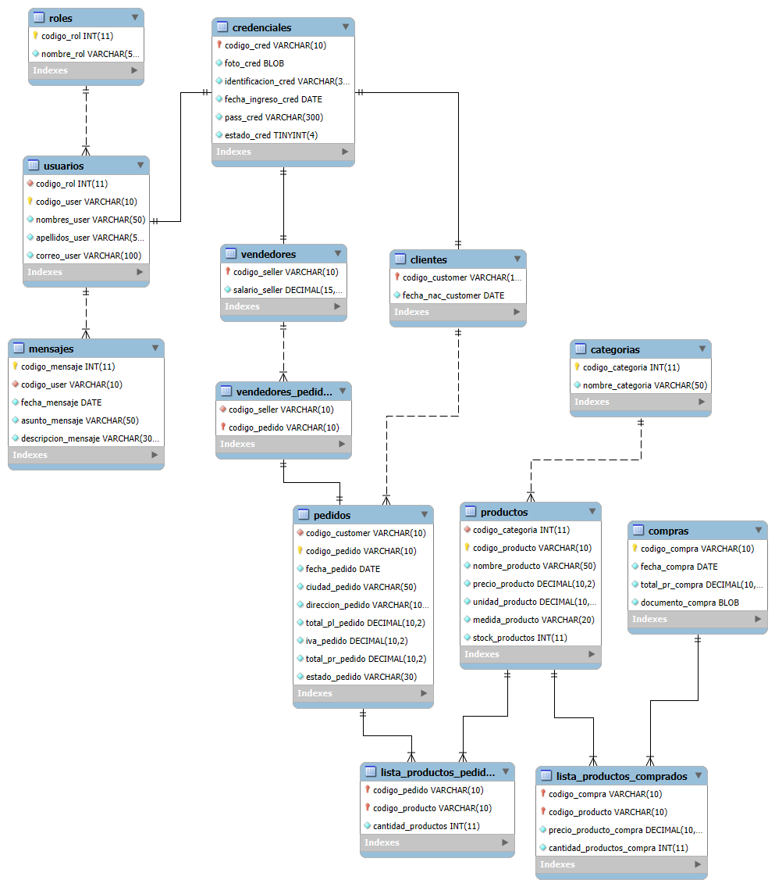

# Paso 2: Segunda Forma Normal (2FN)

## 📚 Explicación

La **Segunda Forma Normal (2FN)** establece que una tabla está en 2FN si y solo si:

1. **Ya está en 1FN** (requisito previo).
2. **Todos los atributos no clave dependen completamente de la clave primaria**, es decir, **no existen dependencias funcionales parciales**.

> 🔑 **Dependencia funcional parcial**: ocurre cuando un atributo no clave depende **solo de una parte** de una clave primaria **compuesta**. Esto solo puede suceder en tablas cuya PK esté formada por **más de una columna**.

**Regla práctica:** si una tabla tiene PK simple (una sola columna), **automáticamente cumple 2FN** (no puede haber dependencias parciales sobre una clave de un solo atributo). Por lo tanto, en este paso nos enfocamos **solo en las tablas con PK compuesta**.

---

## 🔍 Análisis de las tablas con PK compuesta

Tras el Paso 1, las tablas con PK compuesta son:

| Tabla | PK compuesta |
|---|---|
| `LISTA_PRODUCTOS_PEDIDOS` | `(codigo_pedido, codigo_producto)` |
| `LISTA_PRODUCTOS_COMPRADOS` | `(codigo_compra, codigo_producto)` |
| `VENDEDORES_PEDIDOS` | *(PK simple `codigo_pedido`, no aplica)* |

Analicemos cada una.

---

### 🔎 Tabla `LISTA_PRODUCTOS_PEDIDOS`

**Estructura actual:**
```
PK (codigo_pedido, codigo_producto)
   cantidad_productos
```

**Dependencias funcionales:**
- `(codigo_pedido, codigo_producto) → cantidad_productos` ✅

`cantidad_productos` representa **cuántas unidades de ese producto** se pidieron en **ese pedido específico**. Depende **de la combinación completa** de pedido + producto, no de uno solo por separado:
- No depende solo de `codigo_pedido` (un pedido puede tener varios productos con distintas cantidades).
- No depende solo de `codigo_producto` (un producto puede aparecer en varios pedidos con distintas cantidades).

✅ **`LISTA_PRODUCTOS_PEDIDOS` cumple 2FN.**

---

### 🔎 Tabla `LISTA_PRODUCTOS_COMPRADOS`

**Estructura actual:**
```
PK (codigo_compra, codigo_producto)
   precio_producto_compra
   cantidad_productos_compra
```

**Dependencias funcionales:**
- `(codigo_compra, codigo_producto) → cantidad_productos_compra` ✅
- `(codigo_compra, codigo_producto) → precio_producto_compra` ⚠️ **Aquí está el problema**

Analicemos `precio_producto_compra`:

- **¿Depende de `codigo_compra`?** No. El precio de compra de un producto no cambia según qué compra sea.
- **¿Depende de `codigo_producto`?** Sí. Un producto tiene un precio de compra que se negocia con el proveedor.
- **¿Depende de la combinación `(codigo_compra, codigo_producto)`?** Parcialmente: en la práctica, el `precio_producto_compra` puede variar entre compras (distintos proveedores, descuentos, inflación). Pero **conceptualmente**, el atributo describe una **propiedad del producto en el momento de la compra**.

Hay dos lecturas válidas:

| Interpretación | ¿Dependencia parcial? | ¿Violación de 2FN? |
|---|---|---|
| **A)** El precio de compra **es histórico** (se registra el precio pagado en esa compra específica). | No: depende de `(compra, producto)` porque el precio puede cambiar entre compras. | ❌ No viola 2FN. |
| **B)** El precio de compra es un **atributo del producto** (precio de catálogo del proveedor). | Sí: `codigo_producto → precio_producto_compra`. | ✅ **Viola 2FN**: debe moverse a `PRODUCTOS`. |

Como el contexto indica que **la tienda compra productos con ánimo de lucro** y que se registra el **documento de compra**, la interpretación **A** es la correcta desde el punto de vista de negocio: el precio pagado es histórico. Sin embargo, aquí está la **trampa de diseño**:

> ⚠️ La tabla `PRODUCTOS` **no tiene un `precio_compra`**. Solo tiene `precio_producto` (que es el precio de **venta**). Eso significa que **el precio de compra solo existe en `LISTA_PRODUCTOS_COMPRADOS`**, y por tanto **no es una dependencia parcial** sino un dato histórico correctamente ubicado.

✅ **`LISTA_PRODUCTOS_COMPRADOS` cumple 2FN** (con la interpretación A, que es la correcta).

---

### 🔎 Tabla `VENDEDORES_PEDIDOS`

**Estructura actual:**
```
PK (codigo_pedido)
   codigo_seller
```

Aquí hay **un problema de diseño grave**, aunque **no es un problema de 2FN** (la PK es simple). Lo anoto porque afecta el modelado:

- La PK es `codigo_pedido`, lo que significa que **un pedido solo puede tener UN vendedor**.
- Pero el contexto dice: *"los vendedores se ganan una comisión **cada vez** que ayudan a una venta"*. Esto sugiere que **varios vendedores pueden participar en un mismo pedido** (ej. uno atiende, otro empaca, otro cobra).
- Además, **los pedidos en línea no tienen vendedor**, pero la tabla no distingue entre pedido físico y en línea.

**Esto se resolverá en el Paso 4**, cuando modelemos correctamente:
- El **tipo de pedido** (físico vs. en línea).
- La **cardinalidad** correcta (N:M entre pedidos y vendedores).
- La **comisión por vendedor por pedido** (que es un atributo de la relación, no del vendedor).

> 📌 **Conclusión**: `VENDEDORES_PEDIDOS` **no viola 2FN** (PK simple), pero sí tiene un **problema de modelado** que anotaremos para el Paso 4.

---

## ⚠️ Un problema **adicional** que sí conviene resolver ahora: atributos derivados

Aunque **no es estrictamente un problema de 2FN**, el profesor debe señalar que en `PEDIDOS` existen **tres columnas calculadas**:

```
total_pl_pedido   -- total sin IVA (¿"pl" = "por línea"? o "parcial"?)
iva_pedido        -- IVA calculado sobre el total
total_pr_pedido   -- total con IVA
```

Estos tres atributos **se derivan matemáticamente**:

```
total_pl_pedido = Σ (cantidad_productos × precio_producto)   [de LISTA_PRODUCTOS_PEDIDOS]
iva_pedido      = total_pl_pedido × tasa_iva
total_pr_pedido = total_pl_pedido + iva_pedido
```

Almacenar valores calculados **no viola 2FN** (siguen dependiendo de la PK `codigo_pedido`), pero:

1. **Introduce redundancia y riesgo de inconsistencia**: si se modifica un detalle del pedido, los totales pueden quedar desactualizados.
2. **Es un problema de normalización más profundo** que formalmente se aborda en **3FN (dependencia transitiva)** o incluso en **4FN/5FN** según la escuela.

👉 **Decisión pedagógica**: los dejo **anotados como candidatos a eliminar en el Paso 3**, donde analizaremos dependencias transitivas y derivadas. En 2FN **no se tocan** porque siguen dependiendo funcionalmente de la PK completa.

> 💡 **Consejo didáctico**: pídeles a tus estudiantes que **intenten calcular un total a mano** a partir de `LISTA_PRODUCTOS_PEDIDOS` y lo comparen con `PEDIDOS.total_pr_pedido`. Verán que **siempre debería coincidir**, y que si no coincide es porque hay un dato redundante mal mantenido.

---

## ✅ Veredicto del Paso 2

| Tabla | PK | ¿Cumple 2FN? | Observación |
|---|---|---|---|
| `LISTA_PRODUCTOS_PEDIDOS` | Compuesta | ✅ Sí | `cantidad_productos` depende de la PK completa. |
| `LISTA_PRODUCTOS_COMPRADOS` | Compuesta | ✅ Sí | `precio_producto_compra` es histórico (interpretación A). |
| `VENDEDORES_PEDIDOS` | Simple | ✅ Sí (por PK simple) | ⚠️ Problema de modelado (cardinalidad) → Paso 4. |
| Todas las demás | Simple | ✅ Sí (por PK simple) | Sin dependencias parciales posibles. |

> 🎯 **Conclusión**: **tras el Paso 1, el esquema ya cumple 2FN**. No se requiere modificar ninguna tabla para satisfacer 2FN. El Paso 2 sirve como **verificación pedagógica** de que las PKs compuestas creadas en el Paso 1 están bien diseñadas.

---

## 🛠️ ¿Entonces no hay código para este paso?

**Correcto.** No hay cambios estructurales que aplicar para 2FN. Sin embargo, para que tus estudiantes **comprueben** que efectivamente se cumple 2FN, te dejo **pruebas de dependencia funcional** que pueden ejecutar en MySQL.



### 🧪 Pruebas sugeridas

```sql
-- ---------------------------------------------------------
-- PRUEBA 1: LISTA_PRODUCTOS_PEDIDOS cumple 2FN
-- ---------------------------------------------------------
-- Insertar datos de prueba
INSERT INTO CATEGORIAS (nombre_categoria) VALUES ('Bebidas');
INSERT INTO PRODUCTOS VALUES (1, 'PR001', 'Agua 500ml', 2.50, 500, 'ml', 100);
INSERT INTO PRODUCTOS VALUES (1, 'PR002', 'Jugo 1L',    5.00, 1000, 'ml', 50);

INSERT INTO ROLES (nombre_rol) VALUES ('Cliente');
INSERT INTO USUARIOS VALUES (1, 'U001', 'Ana', 'Pérez', 'ana@mail.com');
INSERT INTO CREDENCIALES VALUES ('U001', 0x00, '12345678', '2025-01-01', 'hash', 1);
INSERT INTO CLIENTES VALUES ('U001', '1990-05-10');

INSERT INTO PEDIDOS VALUES
  ('U001', 'P001', '2025-02-01', 'Bogotá', 'Calle 1', 0, 0, 0, 'pendiente');

-- El MISMO producto en DOS pedidos distintos → cantidades independientes
INSERT INTO LISTA_PRODUCTOS_PEDIDOS VALUES ('P001', 'PR001', 3);
INSERT INTO LISTA_PRODUCTOS_PEDIDOS VALUES ('P001', 'PR002', 1);

INSERT INTO PEDIDOS VALUES
  ('U001', 'P002', '2025-02-02', 'Bogotá', 'Calle 2', 0, 0, 0, 'pendiente');
INSERT INTO LISTA_PRODUCTOS_PEDIDOS VALUES ('P002', 'PR001', 7);  -- misma PR001, otra cantidad

-- Verificar: la cantidad depende de (pedido, producto), no de uno solo
SELECT codigo_pedido, codigo_producto, cantidad_productos
FROM LISTA_PRODUCTOS_PEDIDOS
WHERE codigo_producto = 'PR001';
-- Resultado: P001→3, P002→7  ✔ Dependencia total, no parcial.
```

```sql
-- ---------------------------------------------------------
-- PRUEBA 2: LISTA_PRODUCTOS_COMPRADOS cumple 2FN
-- ---------------------------------------------------------
INSERT INTO COMPRAS VALUES ('C001', '2025-01-15', 0, 0x00);
INSERT INTO COMPRAS VALUES ('C002', '2025-02-15', 0, 0x00);

-- Mismo producto comprado a distinto precio en distintas compras
INSERT INTO LISTA_PRODUCTOS_COMPRADOS VALUES ('C001', 'PR001', 1.80, 50);
INSERT INTO LISTA_PRODUCTOS_COMPRADOS VALUES ('C002', 'PR001', 2.00, 30);

-- Verificar: el precio depende de la compra Y del producto (precio histórico)
SELECT codigo_compra, codigo_producto, precio_producto_compra
FROM LISTA_PRODUCTOS_COMPRADOS
WHERE codigo_producto = 'PR001';
-- Resultado: C001→1.80, C002→2.00  ✔ Dependencia total, no parcial.
```

```sql
-- ---------------------------------------------------------
-- PRUEBA 3: Detectar dependencias parciales (consulta genérica)
-- ---------------------------------------------------------
-- Esta consulta lista columnas que dependen SOLO de una parte de la PK compuesta.
-- Para LISTA_PRODUCTOS_PEDIDOS, esperamos que devuelva VACÍO si cumple 2FN.

SELECT
  kcu.TABLE_NAME,
  kcu.COLUMN_NAME  AS columna_pk,
  kcu.ORDINAL_POSITION AS posicion_en_pk
FROM INFORMATION_SCHEMA.KEY_COLUMN_USAGE kcu
JOIN INFORMATION_SCHEMA.TABLE_CONSTRAINTS tc
  ON tc.CONSTRAINT_NAME = kcu.CONSTRAINT_NAME
 AND tc.TABLE_SCHEMA    = kcu.TABLE_SCHEMA
WHERE kcu.TABLE_SCHEMA = 'BBDD_INVENTARIO'
  AND tc.CONSTRAINT_TYPE = 'PRIMARY KEY'
  AND kcu.TABLE_NAME IN ('LISTA_PRODUCTOS_PEDIDOS','LISTA_PRODUCTOS_COMPRADOS')
ORDER BY kcu.TABLE_NAME, kcu.ORDINAL_POSITION;
-- Esto solo lista las PKs compuestas; el docente debe preguntar
-- "¿qué columnas NO clave dependen de una sola de estas?" para razonar 2FN.
```

```sql
-- ---------------------------------------------------------
-- PRUEBA 4 (optativa): demostrar problema de atributos derivados
-- en PEDIDOS (se resolverá en Paso 3)
-- ---------------------------------------------------------
-- Recalcular el total del pedido desde el detalle
SELECT
  lp.codigo_pedido,
  SUM(lp.cantidad_productos * p.precio_producto) AS total_calculado,
  pd.total_pl_pedido                              AS total_almacenado
FROM LISTA_PRODUCTOS_PEDIDOS lp
JOIN PRODUCTOS p ON p.codigo_producto = lp.codigo_producto
JOIN PEDIDOS  pd ON pd.codigo_pedido  = lp.codigo_pedido
GROUP BY lp.codigo_pedido, pd.total_pl_pedido;
-- Si total_calculado ≠ total_almacenado → hay redundancia inconsistente.
-- En el Paso 3 decidiremos si eliminamos total_pl_pedido / iva_pedido / total_pr_pedido.
```

---

## 📋 Resumen del Paso 2

| # | Tabla | ¿Cambio aplicado? | Motivo |
|---|---|---|---|
| 1 | `LISTA_PRODUCTOS_PEDIDOS` | ❌ Ninguno | `cantidad_productos` depende de la PK completa. |
| 2 | `LISTA_PRODUCTOS_COMPRADOS` | ❌ Ninguno | `precio_producto_compra` es histórico → depende de la PK completa. |
| 3 | `VENDEDORES_PEDIDOS` | ⏸️ Pendiente | Problema de **cardinalidad** (no de 2FN) → se resuelve en Paso 4. |
| 4 | `PEDIDOS` | ⏸️ Pendiente | Atributos **derivados** (`total_pl`, `iva`, `total_pr`) → se analizan en Paso 3. |

> ✅ **Resultado del Paso 2**: el esquema **ya cumple 2FN** gracias a las PKs compuestas creadas en el Paso 1. Este paso es de **verificación y razonamiento**, no de reescritura.

---

## ⏭️ ¿Qué viene en el Paso 3?

En el **Paso 3 (Tercera Forma Normal)** vamos a:

- Identificar **dependencias transitivas** (atributos no clave que dependen de **otros atributos no clave**).
- Revisar `USUARIOS → ROLES` (¿es transitiva?).
- Revisar `CREDENCIALES` ↔ `USUARIOS` (la cadena `CLIENTES → CREDENCIALES → USUARIOS`).
- Decidir qué hacer con los **atributos derivados** de `PEDIDOS`.
- Detectar el problema de **`CLIENTES` y `VENDEDORES` colgando de `CREDENCIALES`** (jerarquía invertida).
- **Aquí sí habrá reescritura de código** (probablemente la más grande de todo el ejercicio).

Cuando lo tengas probado y entendido, escribe **"siguiente"** y avanzamos. 🚀

¿Alguna duda sobre la 2FN o sobre por qué el esquema ya la cumple?