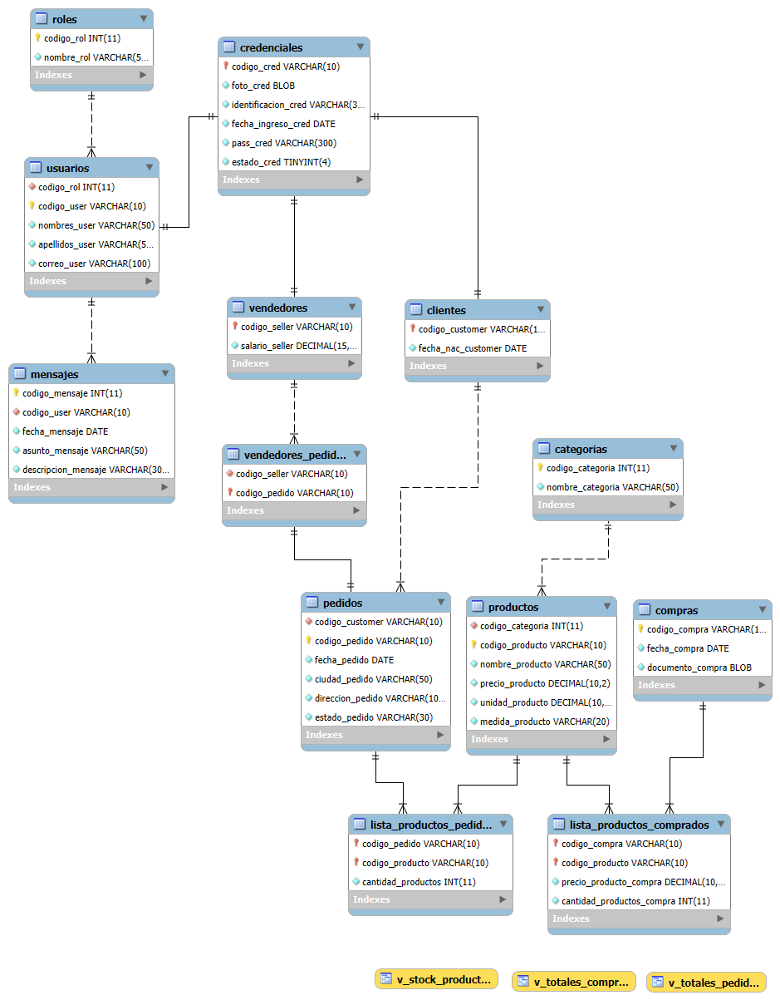

# Paso 3: Tercera Forma Normal (3FN)

## 📚 Explicación

La **Tercera Forma Normal (3FN)** establece que una tabla está en 3FN si y solo si:

1. **Ya está en 2FN** (requisito previo).
2. **No existen dependencias transitivas** entre atributos no clave y la clave primaria.

> 🔑 **Dependencia transitiva**: ocurre cuando un atributo **no clave** depende de **otro atributo no clave** (y este, a su vez, depende de la PK). Es decir:
>
> ```
> PK → A → B     (B depende transitivamente de PK a través de A)
> ```
>
> Si `B` depende de `A` y `A` depende de la PK, entonces `B` **no debería estar en la misma tabla**: `B` pertenece a la tabla donde vive `A`.

**Regla práctica:** cada atributo no clave debe describir **solo y exclusivamente** al sujeto identificado por la PK de su tabla. Si describe a **otro sujeto**, hay dependencia transitiva.

---

## 🔍 Análisis del esquema tras el Paso 2

Voy a revisar tabla por tabla buscando dependencias transitivas.

### 🔎 Tabla `USUARIOS`

```
PK: codigo_user
    codigo_rol     →  depende de codigo_rol (que es FK a ROLES)
    nombres_user
    apellidos_user
    correo_user
```

**Análisis:**
- `codigo_rol` es FK, y **conceptualmente** apunta a un rol. Pero `codigo_rol` **no describe al usuario**, es un **atributo de relación** que asocia al usuario con su rol.
- ¿Hay transitividad? **No estrictamente**, porque no guardamos `nombre_rol` dentro de `USUARIOS`. Si guardáramos `nombre_rol` junto a `codigo_rol`, **sí** habría transitividad (`codigo_user → codigo_rol → nombre_rol`).

✅ **`USUARIOS` cumple 3FN.** Correctamente usa `codigo_rol` como FK en lugar de duplicar `nombre_rol`.

---

### 🔎 Tabla `CREDENCIALES`

```
PK: codigo_cred
    foto_cred
    identificacion_cred
    fecha_ingreso_cred
    pass_cred
    estado_cred
```

**Análisis:**
Todos los atributos describen **la credencial** (su foto, su identificación, su contraseña, etc.). **No hay dependencia transitiva** interna.

✅ **`CREDENCIALES` cumple 3FN.**

> ⚠️ Pero ojo: `CREDENCIALES.codigo_cred` es FK a `USUARIOS.codigo_user`, y **al mismo tiempo** PK de su propia tabla. Esto significa que **cada credencial pertenece a un usuario**, y como `codigo_cred = codigo_user`, hay una **relación 1:1** que en la práctica **funde `USUARIOS` y `CREDENCIALES`**. Eso lo trataremos en el Paso 4 (es un problema de modelado, no de 3FN).

---

### 🔎 Tabla `CLIENTES`

```
PK: codigo_customer
    fecha_nac_customer
```

**Análisis:**
`fecha_nac_customer` describe al cliente. ✅ **Cumple 3FN.**

> ⚠️ Pero de nuevo: `codigo_customer` es FK a `CREDENCIALES.codigo_cred`, y `CREDENCIALES.codigo_cred` es FK a `USUARIOS.codigo_user`. Es una **cadena de herencia invertida**: `CLIENTES → CREDENCIALES → USUARIOS`. Esto lo veremos en el Paso 4.

---

### 🔎 Tabla `VENDEDORES`

```
PK: codigo_seller
    salario_seller
```

**Análisis:**
`salario_seller` describe al vendedor. ✅ **Cumple 3FN.**

---

### 🔎 Tabla `PEDIDOS` — ⚠️ **AQUÍ ESTÁ EL PROBLEMA**

```
PK: codigo_pedido
    codigo_customer    (FK a CLIENTES)
    fecha_pedido
    ciudad_pedido      ← problema
    direccion_pedido   ← problema
    total_pl_pedido    ← derivado
    iva_pedido         ← derivado
    total_pr_pedido    ← derivado
    estado_pedido
```

**Análisis de dependencias transitivas:**

1. **`ciudad_pedido` y `direccion_pedido`:**
   - **¿Describen al pedido?** Sí, son el lugar de **entrega** de *ese* pedido.
   - **¿Dependen de `codigo_customer`?** Parcialmente: la dirección **habitual** del cliente sí depende del cliente, pero la dirección **de entrega de un pedido** puede ser distinta (regalar a otra dirección, envío a oficina, etc.).
   - **Veredicto:** dependen de `codigo_pedido`, **no hay transitividad estricta**. Sin embargo, aquí hay una **decisión de diseño**: si se quiere modelar "el cliente tiene direcciones", hay que **separar `DIRECCIONES_CLIENTE`**. Lo dejo anotado para el **Paso 4**.

2. **`total_pl_pedido`, `iva_pedido`, `total_pr_pedido`:**
   - **¿Describen al pedido?** Sí, pero **no son independientes**: se calculan a partir de los productos del pedido.
   - **Dependencia funcional:** `codigo_pedido → (lista de productos) → total_pl_pedido`. **El total NO depende directamente de la PK**, sino de los **detalles del pedido** (`LISTA_PRODUCTOS_PEDIDOS`).
   - **Veredicto:** **SON ATRIBUTOS DERIVADOS**, y la 3FN (en su acepción estricta) los considera **dependencias transitivas** porque dependen de una **agregación** de otra tabla.
   - **Solución:** **eliminarlos de `PEDIDOS`** y calcularlos **por consulta (VIEW)** cuando se necesiten.

   > 📝 **Nota académica importante:** Algunos autores distinguen entre "dependencia transitiva" (atributo → atributo no clave) y "atributo derivado" (calculado a partir de otras tablas). La 3FN formalmente prohíbe **ambos**. En el mundo real, a veces se **desnormaliza** guardando totales por rendimiento, pero eso es una **decisión consciente** que rompe 3FN y debe documentarse.

3. **`estado_pedido`:**
   - Es una cadena (`pendiente`, `enviado`, etc.). Podría normalizarse a una tabla `ESTADOS_PEDIDO` para evitar typos, pero **no es transitividad estricta** (no depende de otro atributo no clave). Lo anoto para el Paso 4.

✅➡️ **`PEDIDOS` debe modificarse:** eliminar los tres totales derivados.

---

### 🔎 Tabla `PRODUCTOS` — ⚠️ **SEGUNDO PROBLEMA**

```
PK: codigo_producto
    codigo_categoria    (FK a CATEGORIAS)
    nombre_producto
    precio_producto
    unidad_producto
    medida_producto
    stock_productos     ← problema de fondo
```

**Análisis:**

1. **`codigo_categoria`:** es FK, no hay transitividad (no guardamos `nombre_categoria`). ✅
2. **`stock_productos`:** 
   - **¿Describe al producto?** Sí, es el stock **actual**.
   - **¿Depende transitivamente de otro atributo?** No directamente, **pero** el stock es un **valor derivado** de:
     ```
     stock = stock_inicial + compras - ventas
     ```
   - **Veredicto:** es un **atributo derivado de agregaciones** de `LISTA_PRODUCTOS_COMPRADOS` y `LISTA_PRODUCTOS_PEDIDOS`. **Técnicamente viola 3FN** si somos estrictos (depende de otras tablas, no del producto en sí).
   - **Solución práctica:** hay dos opciones:
     - **A) Eliminarlo** y calcularlo con una vista que sume compras y reste ventas.
     - **B) Mantenerlo desnormalizado** por rendimiento (el cálculo en cada consulta es costoso), pero **documentar** que es desnormalización intencional y **actualizarlo con triggers o procedimientos**.
   - **Mi recomendación pedagógica:** **eliminarlo** en el script normalizado y crear una **VIEW `V_STOCK_PRODUCTOS`**. Así los estudiantes ven **cómo se calcula** y entienden el costo de la normalización.

3. **`medida_producto` y `unidad_producto`:**
   - `medida_producto` es texto (`"ml"`, `"g"`, `"und"`).
   - `unidad_producto` es **numérico** (500, 1000, etc.).
   - **No hay transitividad**, describen al producto. ✅

4. **`precio_producto`:** describe al producto (precio de venta actual). ✅

✅➡️ **`PRODUCTOS` debe modificarse:** eliminar `stock_productos`.

---

### 🔎 Tabla `MENSAJES`

```
PK: codigo_mensaje
    codigo_user   (FK a USUARIOS)
    fecha_mensaje
    asunto_mensaje
    descripcion_mensaje
```

**Análisis:** todos los atributos describen al mensaje. ✅ **Cumple 3FN.**

---

### 🔎 Tabla `COMPRAS`

```
PK: codigo_compra
    fecha_compra
    total_pr_compra   ← derivado
    documento_compra
```

**Análisis:**
- `total_pr_compra` es **derivado** de `Σ(precio_producto_compra × cantidad_productos_compra)` en `LISTA_PRODUCTOS_COMPRADOS`. **Violación de 3FN** por atributo derivado.
- **Solución:** eliminarlo y calcularlo por consulta.

✅➡️ **`COMPRAS` debe modificarse:** eliminar `total_pr_compra`.

---

### 🔎 Tabla `VENDEDORES_PEDIDOS`

Ya vimos en el Paso 2 que tiene problemas de **cardinalidad**. **No viola 3FN** (PK simple, sin atributos no clave), pero lo **rediseñaremos** en el Paso 4.

---

## 🛠️ Solución de problemas detectados

| # | Tabla | Problema | Solución |
|---|---|---|---|
| 1 | `PEDIDOS` | `total_pl_pedido`, `iva_pedido`, `total_pr_pedido` son **derivados** de `LISTA_PRODUCTOS_PEDIDOS`. | **Eliminarlos** y calcularlos vía VIEW. |
| 2 | `PRODUCTOS` | `stock_productos` es **derivado** de compras y ventas. | **Eliminarlo** y calcularlo vía VIEW. |
| 3 | `COMPRAS` | `total_pr_compra` es **derivado** de `LISTA_PRODUCTOS_COMPRADOS`. | **Eliminarlo** y calcularlo vía VIEW. |
| 4 | `PEDIDOS` | `estado_pedido` como texto libre (riesgo de typos). | *(Anotado para Paso 4)*: normalizar a tabla `ESTADOS_PEDIDO`. |
| 5 | `PEDIDOS` | `ciudad_pedido`/`direccion_pedido` podrían modelarse como direcciones del cliente. | *(Anotado para Paso 4)*: separar `DIRECCIONES_CLIENTE`. |

> 🎯 **Conclusión del Paso 3:** el esquema cumple 3FN **después de eliminar los atributos derivados**. No hay dependencias transitivas "puras" (atributo no clave → atributo no clave), pero sí hay **atributos calculados a partir de otras tablas**, que la 3FN prohíbe.

---

## ✅ Código completo corregido (1FN + 2FN + 3FN)

A continuación, el script **completo** con todos los cambios aplicados. Los cambios del **Paso 3** están marcados con `-- [3FN]`.

```sql
DROP DATABASE IF EXISTS BBDD_INVENTARIO;
-- -----------------------------------------------------
-- Estructura BBDD_INVENTARIO - VERSIÓN 1FN + 2FN + 3FN
-- -----------------------------------------------------
CREATE SCHEMA BBDD_INVENTARIO DEFAULT CHARACTER SET utf8;
USE BBDD_INVENTARIO;

-- -----------------------------------------------------
-- Tabla ROLES
-- -----------------------------------------------------
CREATE TABLE ROLES (
  codigo_rol INT NOT NULL AUTO_INCREMENT,
  nombre_rol VARCHAR(50) NOT NULL,
  PRIMARY KEY (codigo_rol)
) ENGINE = InnoDB;

-- -----------------------------------------------------
-- Tabla USUARIOS
-- -----------------------------------------------------
CREATE TABLE USUARIOS (
  codigo_rol INT NOT NULL,
  codigo_user VARCHAR(10) NOT NULL,
  nombres_user VARCHAR(50) NOT NULL,
  apellidos_user VARCHAR(50) NOT NULL,
  correo_user VARCHAR(100) NOT NULL,
  PRIMARY KEY (codigo_user),
  INDEX ind_usuario_rol (codigo_rol ASC),
  UNIQUE INDEX uq_correo_user (correo_user ASC),
  CONSTRAINT fk_usuario_rol
    FOREIGN KEY (codigo_rol)
    REFERENCES ROLES (codigo_rol)
    ON DELETE CASCADE
    ON UPDATE CASCADE
) ENGINE = InnoDB;

-- -----------------------------------------------------
-- Tabla CREDENCIALES
-- -----------------------------------------------------
CREATE TABLE CREDENCIALES (
  codigo_cred VARCHAR(10) NOT NULL,
  foto_cred BLOB NOT NULL,
  identificacion_cred VARCHAR(30) NOT NULL,
  fecha_ingreso_cred DATE NOT NULL,
  pass_cred VARCHAR(300) NOT NULL,
  estado_cred TINYINT NOT NULL,
  PRIMARY KEY (codigo_cred),
  UNIQUE INDEX uq_identificacion_cred (identificacion_cred ASC),
  CONSTRAINT chk_evitarPersona
    CHECK (codigo_cred NOT LIKE '%person%'),
  CONSTRAINT fk_credencial_usuario
    FOREIGN KEY (codigo_cred)
    REFERENCES USUARIOS (codigo_user)
    ON DELETE CASCADE
    ON UPDATE CASCADE
) ENGINE = InnoDB;

-- -----------------------------------------------------
-- Tabla MENSAJES  -- [1FN] PK agregada
-- -----------------------------------------------------
CREATE TABLE MENSAJES (
  codigo_mensaje INT NOT NULL AUTO_INCREMENT,
  codigo_user VARCHAR(10) NOT NULL,
  fecha_mensaje DATE NOT NULL,
  asunto_mensaje VARCHAR(50) NOT NULL,
  descripcion_mensaje VARCHAR(300) NOT NULL,
  PRIMARY KEY (codigo_mensaje),
  INDEX ind_mensaje_usuario (codigo_user ASC),
  CONSTRAINT fk_mensaje_usuario
    FOREIGN KEY (codigo_user)
    REFERENCES USUARIOS (codigo_user)
    ON DELETE CASCADE
    ON UPDATE CASCADE
) ENGINE = InnoDB;

-- -----------------------------------------------------
-- Tabla CATEGORIAS
-- -----------------------------------------------------
CREATE TABLE CATEGORIAS (
  codigo_categoria INT NOT NULL AUTO_INCREMENT,
  nombre_categoria VARCHAR(50) NOT NULL,
  PRIMARY KEY (codigo_categoria)
) ENGINE = InnoDB;

-- -----------------------------------------------------
-- Tabla PRODUCTOS  -- [3FN] Se elimina stock_productos (derivado)
-- -----------------------------------------------------
CREATE TABLE PRODUCTOS (
  codigo_categoria INT NOT NULL,
  codigo_producto VARCHAR(10) NOT NULL,
  nombre_producto VARCHAR(50) NOT NULL,
  precio_producto DECIMAL(10,2) NOT NULL,
  unidad_producto DECIMAL(10,2) NOT NULL,
  medida_producto VARCHAR(20) NOT NULL,
  -- [3FN] stock_productos ELIMINADO: se calcula en V_STOCK_PRODUCTOS
  PRIMARY KEY (codigo_producto),
  INDEX ind_producto_categoria (codigo_categoria ASC),
  CONSTRAINT fk_producto_categoria
    FOREIGN KEY (codigo_categoria)
    REFERENCES CATEGORIAS (codigo_categoria)
    ON DELETE CASCADE
    ON UPDATE CASCADE
) ENGINE = InnoDB;

-- -----------------------------------------------------
-- Tabla CLIENTES
-- -----------------------------------------------------
CREATE TABLE CLIENTES (
  codigo_customer VARCHAR(10) NOT NULL,
  fecha_nac_customer DATE NOT NULL,
  PRIMARY KEY (codigo_customer),
  CONSTRAINT chk_soloCliente
    CHECK (codigo_customer LIKE '%customer%'),
  CONSTRAINT fk_cliente_credencial
    FOREIGN KEY (codigo_customer)
    REFERENCES CREDENCIALES (codigo_cred)
    ON DELETE CASCADE
    ON UPDATE CASCADE
) ENGINE = InnoDB;

-- -----------------------------------------------------
-- Tabla PEDIDOS  -- [3FN] Se eliminan totales derivados
-- -----------------------------------------------------
CREATE TABLE PEDIDOS (
  codigo_customer VARCHAR(10) NOT NULL,
  codigo_pedido VARCHAR(10) NOT NULL,
  fecha_pedido DATE NOT NULL,
  ciudad_pedido VARCHAR(50) NOT NULL,
  direccion_pedido VARCHAR(100) NOT NULL,
  -- [3FN] total_pl_pedido, iva_pedido, total_pr_pedido ELIMINADOS
  --       Se calculan en V_TOTALES_PEDIDOS
  estado_pedido VARCHAR(30) NOT NULL,
  PRIMARY KEY (codigo_pedido),
  INDEX ind_pedido_cliente (codigo_customer ASC),
  CONSTRAINT fk_pedido_cliente
    FOREIGN KEY (codigo_customer)
    REFERENCES CLIENTES (codigo_customer)
    ON DELETE CASCADE
    ON UPDATE CASCADE
) ENGINE = InnoDB;

-- -----------------------------------------------------
-- Tabla LISTA_PRODUCTOS_PEDIDOS  -- [1FN] PK compuesta
-- -----------------------------------------------------
CREATE TABLE LISTA_PRODUCTOS_PEDIDOS (
  codigo_pedido VARCHAR(10) NOT NULL,
  codigo_producto VARCHAR(10) NOT NULL,
  cantidad_productos INT NOT NULL,
  PRIMARY KEY (codigo_pedido, codigo_producto),
  INDEX ind_lista_producto_producto (codigo_producto ASC),
  CONSTRAINT fk_lista_productos_pedido
    FOREIGN KEY (codigo_pedido)
    REFERENCES PEDIDOS (codigo_pedido)
    ON DELETE CASCADE
    ON UPDATE CASCADE,
  CONSTRAINT fk_lista_productos_producto
    FOREIGN KEY (codigo_producto)
    REFERENCES PRODUCTOS (codigo_producto)
    ON DELETE CASCADE
    ON UPDATE CASCADE
) ENGINE = InnoDB;

-- -----------------------------------------------------
-- Tabla VENDEDORES
-- -----------------------------------------------------
CREATE TABLE VENDEDORES (
  codigo_seller VARCHAR(10) NOT NULL,
  salario_seller DECIMAL(15,2) NOT NULL,
  PRIMARY KEY (codigo_seller),
  CONSTRAINT chk_soloVendedor
    CHECK (codigo_seller LIKE '%seller%'),
  CONSTRAINT fk_vendedor_credencial
    FOREIGN KEY (codigo_seller)
    REFERENCES CREDENCIALES (codigo_cred)
    ON DELETE CASCADE
    ON UPDATE CASCADE
) ENGINE = InnoDB;

-- -----------------------------------------------------
-- Tabla VENDEDORES_PEDIDOS
-- (Se rediseñará en Paso 4 por problema de cardinalidad)
-- -----------------------------------------------------
CREATE TABLE VENDEDORES_PEDIDOS (
  codigo_seller VARCHAR(10) NOT NULL,
  codigo_pedido VARCHAR(10) NOT NULL,
  INDEX ind_credencial_pedido_vendedor (codigo_seller ASC),
  PRIMARY KEY (codigo_pedido),
  CONSTRAINT fk_credencial_pedido_vendedor
    FOREIGN KEY (codigo_seller)
    REFERENCES VENDEDORES (codigo_seller)
    ON DELETE CASCADE
    ON UPDATE CASCADE,
  CONSTRAINT fk_credencial_pedido_pedido
    FOREIGN KEY (codigo_pedido)
    REFERENCES PEDIDOS (codigo_pedido)
    ON DELETE CASCADE
    ON UPDATE CASCADE
) ENGINE = InnoDB;

-- -----------------------------------------------------
-- Tabla COMPRAS  -- [3FN] Se elimina total_pr_compra (derivado)
-- -----------------------------------------------------
CREATE TABLE COMPRAS (
  codigo_compra VARCHAR(10) NOT NULL,
  fecha_compra DATE NOT NULL,
  -- [3FN] total_pr_compra ELIMINADO: se calcula en V_TOTALES_COMPRAS
  documento_compra BLOB NOT NULL,
  PRIMARY KEY (codigo_compra)
) ENGINE = InnoDB;

-- -----------------------------------------------------
-- Tabla LISTA_PRODUCTOS_COMPRADOS  -- [1FN] PK compuesta + tipo corregido
-- -----------------------------------------------------
CREATE TABLE LISTA_PRODUCTOS_COMPRADOS (
  codigo_compra VARCHAR(10) NOT NULL,
  codigo_producto VARCHAR(10) NOT NULL,
  precio_producto_compra DECIMAL(10,2) NOT NULL,
  cantidad_productos_compra INT NOT NULL,
  PRIMARY KEY (codigo_compra, codigo_producto),
  INDEX ind_lista_prod_comp_productos (codigo_producto ASC),
  CONSTRAINT fk_lista_prod_comp_productos
    FOREIGN KEY (codigo_producto)
    REFERENCES PRODUCTOS (codigo_producto)
    ON DELETE CASCADE
    ON UPDATE CASCADE,
  CONSTRAINT fk_lista_prod_comp_compra
    FOREIGN KEY (codigo_compra)
    REFERENCES COMPRAS (codigo_compra)
    ON DELETE CASCADE
    ON UPDATE CASCADE
) ENGINE = InnoDB;

-- =====================================================
-- VISTAS QUE REEMPLAZAN LOS ATRIBUTOS DERIVADOS (3FN)
-- =====================================================

-- [3FN] Vista para el stock actual de cada producto
CREATE OR REPLACE VIEW V_STOCK_PRODUCTOS AS
SELECT
  p.codigo_producto,
  p.nombre_producto,
  COALESCE(compras.total_comprado, 0) - COALESCE(ventas.total_vendido, 0) AS stock_actual
FROM PRODUCTOS p
LEFT JOIN (
  SELECT codigo_producto, SUM(cantidad_productos_compra) AS total_comprado
  FROM LISTA_PRODUCTOS_COMPRADOS
  GROUP BY codigo_producto
) compras ON compras.codigo_producto = p.codigo_producto
LEFT JOIN (
  SELECT codigo_producto, SUM(cantidad_productos) AS total_vendido
  FROM LISTA_PRODUCTOS_PEDIDOS
  GROUP BY codigo_producto
) ventas ON ventas.codigo_producto = p.codigo_producto;

-- [3FN] Vista para los totales de cada pedido (sin IVA, IVA y con IVA)
-- Nota: la tasa de IVA se asume como parámetro; aquí usamos 0.19 (19%) como ejemplo.
-- En el Paso 4 se sugerirá una tabla PARAMETROS_IMPUESTOS.
CREATE OR REPLACE VIEW V_TOTALES_PEDIDOS AS
SELECT
  pd.codigo_pedido,
  pd.codigo_customer,
  pd.fecha_pedido,
  COALESCE(SUM(lp.cantidad_productos * pr.precio_producto), 0)            AS total_pl_pedido,
  COALESCE(SUM(lp.cantidad_productos * pr.precio_producto), 0) * 0.19     AS iva_pedido,
  COALESCE(SUM(lp.cantidad_productos * pr.precio_producto), 0) * 1.19     AS total_pr_pedido
FROM PEDIDOS pd
LEFT JOIN LISTA_PRODUCTOS_PEDIDOS lp ON lp.codigo_pedido  = pd.codigo_pedido
LEFT JOIN PRODUCTOS              pr ON pr.codigo_producto = lp.codigo_producto
GROUP BY pd.codigo_pedido, pd.codigo_customer, pd.fecha_pedido;

-- [3FN] Vista para los totales de cada compra
CREATE OR REPLACE VIEW V_TOTALES_COMPRAS AS
SELECT
  c.codigo_compra,
  c.fecha_compra,
  COALESCE(SUM(lpc.precio_producto_compra * lpc.cantidad_productos_compra), 0) AS total_pr_compra
FROM COMPRAS c
LEFT JOIN LISTA_PRODUCTOS_COMPRADOS lpc ON lpc.codigo_compra = c.codigo_compra
GROUP BY c.codigo_compra, c.fecha_compra;
```



---

## 📋 Resumen del Paso 3

| # | Tabla | Cambio aplicado | Motivo |
|---|---|---|---|
| 1 | `PEDIDOS` | Se eliminaron `total_pl_pedido`, `iva_pedido`, `total_pr_pedido` | Atributos derivados (violan 3FN). Se reemplazan por `V_TOTALES_PEDIDOS`. |
| 2 | `PRODUCTOS` | Se eliminó `stock_productos` | Atributo derivado de compras − ventas (viola 3FN). Se reemplaza por `V_STOCK_PRODUCTOS`. |
| 3 | `COMPRAS` | Se eliminó `total_pr_compra` | Atributo derivado (viola 3FN). Se reemplaza por `V_TOTALES_COMPRAS`. |
| 4 | (nuevas) | Se crearon 3 VIEWs | Para calcular los valores derivados en tiempo de consulta. |

> ✅ **Resultado del Paso 3:** todas las tablas cumplen **1FN + 2FN + 3FN**. Los atributos derivados ahora se calculan mediante **vistas**, eliminando la redundancia y el riesgo de inconsistencia.

---

## 🧪 Pruebas sugeridas

```sql
-- ---------------------------------------------------------
-- PRUEBA 1: comprobar que las vistas devuelven los totales
-- ---------------------------------------------------------
INSERT INTO CATEGORIAS (nombre_categoria) VALUES ('Bebidas');
INSERT INTO PRODUCTOS VALUES (1, 'PR001', 'Agua 500ml', 2.50, 500, 'ml');
INSERT INTO PRODUCTOS VALUES (1, 'PR002', 'Jugo 1L',    5.00, 1000, 'ml');

INSERT INTO ROLES (nombre_rol) VALUES ('Cliente');
INSERT INTO USUARIOS VALUES (1, 'U001', 'Ana', 'Pérez', 'ana@mail.com');
INSERT INTO CREDENCIALES VALUES ('U001', 0x00, '12345678', '2025-01-01', 'hash', 1);
INSERT INTO CLIENTES VALUES ('U001', '1990-05-10');

INSERT INTO PEDIDOS VALUES
  ('U001', 'P001', '2025-02-01', 'Bogotá', 'Calle 1', 'pendiente');
INSERT INTO LISTA_PRODUCTOS_PEDIDOS VALUES ('P001', 'PR001', 3);
INSERT INTO LISTA_PRODUCTOS_PEDIDOS VALUES ('P001', 'PR002', 1);

-- Debe devolver: total_pl = 3*2.50 + 1*5.00 = 12.50
--                 iva     = 12.50 * 0.19  = 2.375
--                 total_pr= 12.50 * 1.19  = 14.875
SELECT * FROM V_TOTALES_PEDIDOS WHERE codigo_pedido = 'P001';

-- ---------------------------------------------------------
-- PRUEBA 2: comprobar que el stock se calcula
-- ---------------------------------------------------------
INSERT INTO COMPRAS VALUES ('C001', '2025-01-15', 0x00);
INSERT INTO LISTA_PRODUCTOS_COMPRADOS VALUES ('C001', 'PR001', 1.80, 50);
INSERT INTO LISTA_PRODUCTOS_COMPRADOS VALUES ('C001', 'PR002', 3.50, 20);

-- Stock esperado: PR001 = 50 - 3 = 47; PR002 = 20 - 1 = 19
SELECT * FROM V_STOCK_PRODUCTOS;

-- ---------------------------------------------------------
-- PRUEBA 3: comprobar que los totales de compra se calculan
-- ---------------------------------------------------------
-- total esperado: 50*1.80 + 20*3.50 = 90 + 70 = 160
SELECT * FROM V_TOTALES_COMPRAS WHERE codigo_compra = 'C001';

-- ---------------------------------------------------------
-- PRUEBA 4: verificar que no queda ningún atributo derivado
-- ---------------------------------------------------------
SELECT TABLE_NAME, COLUMN_NAME
FROM INFORMATION_SCHEMA.COLUMNS
WHERE TABLE_SCHEMA = 'BBDD_INVENTARIO'
  AND COLUMN_NAME IN ('total_pl_pedido','iva_pedido','total_pr_pedido',
                      'stock_productos','total_pr_compra');
-- Debe devolver 0 filas.
```

---

## ⚠️ Advertencias pedagógicas sobre la desnormalización

Es importante que tus estudiantes entiendan que **la 3FN no es dogma**:

- **Ventaja de eliminar atributos derivados:** no hay inconsistencias, no hay que "actualizar" los totales cuando cambia el detalle, y una sola fuente de verdad.
- **Desventaja:** las consultas son más costosas (JOIN + agregación).
- **En producción real**, muchas veces se **desnormaliza intencionalmente** guardando `total_pr_pedido` o `stock_productos` **por rendimiento**, pero se hace con **triggers o procedimientos** que garantizan la consistencia. Esto **rompe 3FN**, y hay que **documentarlo explícitamente**.

> 💡 **Actividad para clase:** pídeles que comparen el tiempo de `SELECT * FROM V_STOCK_PRODUCTOS` vs. un `SELECT stock_productos FROM PRODUCTOS`. Con pocos datos la diferencia es nula; con 1M de productos se vuelve notable. Eso abre la discusión sobre **cuándo desnormalizar**.

---

## ⏭️ ¿Qué viene en el Paso 4?

En el **Paso 4 (Mejoras a la base de datos)** vamos a proponer **mejoras de modelado** que van **más allá de 3FN** (formas normales superiores, decisiones de negocio, integridad, rendimiento):

1. **Jerarquía invertida `USUARIOS → CREDENCIALES → CLIENTES/VENDEDORES`** → rediseñar como herencia correcta.
2. **`VENDEDORES_PEDIDOS` con cardinalidad errónea** → debe ser N:M y admitir comisión.
3. **Pedidos físicos vs. pedidos en línea** → no todos tienen vendedor ni domicilio.
4. **Pago y método de pago** → el contexto lo exige y **no está modelado**.
5. **Domicilios** → el contexto lo exige y **no está modelado**.
6. **Comisión por vendedor** → el contexto lo exige y **no está modelado**.
7. **Reemplazar restricciones `CHECK ... LIKE '%person%'`** por un atributo `tipo_usuario`.
8. **Normalizar `estado_pedido`** a tabla `ESTADOS_PEDIDO`.
9. **Parámetros de IVA** en tabla en lugar de hard-coded en la vista.
10. **Almacenar BLOB como ruta de archivo** en lugar de binario en BD.
11. **`DIRECCIONES_CLIENTE`** como tabla aparte (1:N cliente–direcciones).

Será el paso más **creativo y de diseño**, y el que más se acerque al **modelo final profesional**.

Cuando lo tengas probado y entendido, escribe **"siguiente"** y avanzamos. 🚀

¿Alguna duda sobre la 3FN, las dependencias transitivas o las vistas?