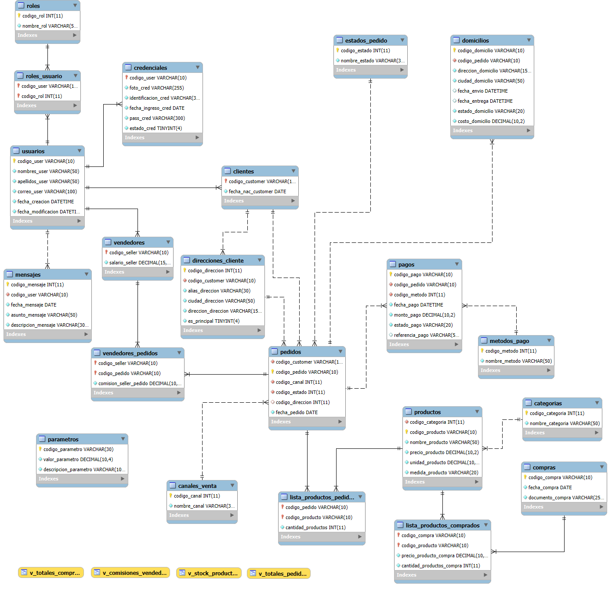

# Paso 4: Mejoras a la base de datos propuesta

## 📚 Explicación

Hasta el Paso 3 logramos que el esquema cumpla **1FN + 2FN + 3FN**. Sin embargo, una base de datos **normalizada no es automáticamente una buena base de datos**. La normalización garantiza **integridad lógica**, pero hay otros aspectos que también importan:

1. **Fidelidad al dominio del negocio** (¿el modelo representa lo que la empresa realmente hace?).
2. **Cardinalidad correcta de las relaciones** (1:1, 1:N, N:M).
3. **Requisitos del contexto que no están modelados** (pago, método de pago, domicilio, comisión).
4. **Integridad y validación** (CHECKs frágiles, estados como texto libre).
5. **Rendimiento y mantenibilidad** (BLOB en BD, índices, parámetros configurables).
6. **Formas normales superiores** (4FN: dependencias multivaluadas; 5FN: dependencias de reunión).

En este paso vamos a **revisar el modelo contra el contexto del negocio** y proponer mejoras **una por una**, explicando **por qué** cada cambio mejora el diseño.

---

## 🔍 Análisis del contexto vs. el modelo actual

Repasemos el contexto del negocio y contrastémoslo con lo que el modelo tiene:

| Requisito del contexto | ¿Modelado? | Observación |
|---|---|---|
| Tienda vende en **local físico** y **en línea** | ❌ No | `PEDIDOS` no distingue el canal. |
| Compra y vende productos con **ánimo de lucro** | ✅ Sí | `COMPRAS` y `PEDIDOS` existen. |
| Lleva **stock / inventario** | ✅ Sí (vía vista) | `V_STOCK_PRODUCTOS`. |
| Vendedores ganan **comisión** por venta en local | ❌ No | No hay tabla de comisiones. |
| Vendedores **no** participan en ventas en línea | ⚠️ Parcial | `VENDEDORES_PEDIDOS` existe pero no distingue. |
| Cada venta en línea requiere **domicilio** | ❌ No | No hay tabla de domicilios/envíos. |
| Todos los pedidos deben registrar **pago** y **método de pago** | ❌ No | No existe tabla `PAGOS`. |
| **Usuarios** pueden ser clientes o vendedores | ⚠️ Parcial | Herencia invertida (ver abajo). |

**Conclusión:** el modelo actual cubre **lo básico del inventario**, pero **le faltan piezas clave del negocio**. Este paso las agrega.

---

## 🛠️ Mejora 1: Rediseñar la jerarquía `USUARIOS → CREDENCIALES → CLIENTES/VENDEDORES`

### 🔎 Problema

El modelo actual tiene esta cadena de FKs:

```
USUARIOS (codigo_user)
    ↑
CREDENCIALES (codigo_cred = codigo_user)
    ↑
CLIENTES (codigo_customer = codigo_cred)
VENDEDORES (codigo_seller = codigo_cred)
```

Esto tiene **varios problemas graves**:

1. **Herencia invertida**: en el modelo, un "cliente" **contiene** a una "credencial" que **contiene** a un "usuario". Conceptualmente debería ser al revés: **un usuario ES un cliente** (o un vendedor), y **tiene** una credencial.
2. **`CREDENCIALES` como puente**: obliga a que **todo cliente o vendedor tenga credencial**, lo cual puede no ser deseado (un cliente ocasional sin cuenta web no debería tener credencial).
3. **Restricciones `CHECK ... LIKE '%person%'` / `'%customer%'` / `'%seller%'`**: validan el rol **por el contenido del código**, lo cual es **frágil** (basta con que alguien teclee mal el código y la validación se rompe; y si se cambia el prefijo, hay que cambiar el CHECK).
4. **Un usuario no puede ser cliente y vendedor a la vez** (o al menos no está modelado que pueda serlo).
5. **`USUARIOS.codigo_rol`** ya existe, pero **no se usa** para distinguir tipos de usuario. Hay una duplicación conceptual entre `ROLES` y la jerarquía `CLIENTES/VENDEDORES`.

### ✅ Solución

Reorganizar el modelo así:

```
USUARIOS (codigo_user)  ── tiene 1:1 ──►  CREDENCIALES (codigo_user)
    │
    └── 1:N ──► ROLES_USUARIO (N:M entre USUARIOS y ROLES)
                        │
                        └── ROLES: 'cliente', 'vendedor', 'admin', etc.

CLIENTES (codigo_customer) ── 1:1 ──► USUARIOS (codigo_user)
VENDEDORES (codigo_seller) ── 1:1 ──► USUARIOS (codigo_user)
```

**Ventajas:**
- **Elimina la herencia invertida**: `CREDENCIALES` cuelga de `USUARIOS`, no al revés.
- **Los roles se asignan vía `ROLES_USUARIO`** (N:M), por lo que un usuario puede ser **cliente y vendedor a la vez**.
- **`CLIENTES` y `VENDEDORES` son tablas de especialización** con sus atributos propios, que referencian a `USUARIOS`.
- **Se eliminan los CHECKs frágiles**: el tipo se determina por los roles asignados, no por el contenido del código.

> 💡 **Nota pedagógica:** esto es una **especialización** (subtipos de usuario). La forma "correcta" depende de cada escuela:
> - **Una sola tabla `USUARIOS` con un campo `tipo`**: simple pero propenso a NULLs.
> - **Tabla `USUARIOS` + tablas de especialización** (lo que propongo): más limpio, evita NULLs.
> - **Herencia con tabla puente**: más complejo, útil si hay muchos tipos.
>
> Propongo **USUARIOS + especialización** porque es lo más cercano al modelo original y el más didáctico.

---

## 🛠️ Mejora 2: Corregir `VENDEDORES_PEDIDOS` (cardinalidad y comisión)

### 🔎 Problema

La tabla actual:
```sql
CREATE TABLE VENDEDORES_PEDIDOS (
  codigo_seller VARCHAR(10) NOT NULL,
  codigo_pedido VARCHAR(10) NOT NULL,
  PRIMARY KEY (codigo_pedido)   -- ← ¡PK simple!
);
```

Esto implica:
- **Un pedido solo puede tener un vendedor**.
- **Un vendedor puede tener muchos pedidos**.
- **No se registra la comisión**.

Pero el contexto dice: *"los vendedores se ganan una comisión **cada vez que ayudan a una venta**"*. Esto sugiere:
- **Varios vendedores pueden participar en un mismo pedido** (ej. uno atiende, otro empaca).
- La **comisión** se paga **por vendedor por pedido**, no es un atributo ni del vendedor ni del pedido.
- **Los pedidos en línea no tienen vendedor** (no aplica).

### ✅ Solución

Rediseñar como **N:M con atributos**:

```sql
CREATE TABLE VENDEDORES_PEDIDOS (
  codigo_seller VARCHAR(10) NOT NULL,
  codigo_pedido VARCHAR(10) NOT NULL,
  comision_seller_pedido DECIMAL(10,2) NOT NULL DEFAULT 0.00,  -- NUEVO
  PRIMARY KEY (codigo_seller, codigo_pedido),                  -- PK compuesta
  CONSTRAINT fk_vp_seller
    FOREIGN KEY (codigo_seller) REFERENCES VENDEDORES (codigo_seller),
  CONSTRAINT fk_vp_pedido
    FOREIGN KEY (codigo_pedido) REFERENCES PEDIDOS (codigo_pedido)
);
```

**Ventajas:**
- **PK compuesta** permite que **varios vendedores participen en un mismo pedido**.
- **`comision_seller_pedido`** es un atributo de la **relación** (no del vendedor ni del pedido): cada par (vendedor, pedido) tiene su propia comisión.
- La **restricción de "solo pedidos físicos"** se aplicará con un trigger o se validará en la capa de aplicación (ver Mejora 3).

> 💡 **Nota pedagógica:** este es un ejemplo clásico de **atributo de relación N:M**. Si la comisión dependiera solo del vendedor, sería un atributo de `VENDEDORES`. Si dependiera solo del pedido, sería de `PEDIDOS`. Pero como depende de **ambos**, debe ir en la tabla puente.

---

## 🛠️ Mejora 3: Distinguir pedidos **físicos** vs. **en línea**

### 🔎 Problema

`PEDIDOS` no distingue si el pedido fue en **local físico** o **en línea**. Esto es importante porque:
- En local físico **hay vendedor(es) y comisión**.
- En línea **no hay vendedor** pero **sí hay domicilio**.
- Los **reportes** y **reglas de negocio** difieren.

### ✅ Solución

Agregar una tabla de **canales de venta**:

```sql
CREATE TABLE CANALES_VENTA (
  codigo_canal INT NOT NULL AUTO_INCREMENT,
  nombre_canal VARCHAR(30) NOT NULL,   -- 'Local', 'En línea'
  PRIMARY KEY (codigo_canal)
);
```

Y en `PEDIDOS`:

```sql
ALTER TABLE PEDIDOS ADD COLUMN codigo_canal INT NOT NULL;
ALTER TABLE PEDIDOS ADD CONSTRAINT fk_pedido_canal
  FOREIGN KEY (codigo_canal) REFERENCES CANALES_VENTA (codigo_canal);
```

**Regla de negocio** (validada en aplicación o con trigger):
- Si `codigo_canal = 'Local'` → debe existir al menos una fila en `VENDEDORES_PEDIDOS`.
- Si `codigo_canal = 'En línea'` → debe existir una fila en `DOMICILIOS` y **no** debe haber vendedores.

---

## 🛠️ Mejora 4: Agregar **PAGOS** y **MÉTODOS DE PAGO**

### 🔎 Problema

El contexto dice: *"todos los pedidos deben tener un registro del pago y el método de pago"*. **Esto no está modelado**. Actualmente no hay ninguna tabla de pagos.

### ✅ Solución

```sql
CREATE TABLE METODOS_PAGO (
  codigo_metodo INT NOT NULL AUTO_INCREMENT,
  nombre_metodo VARCHAR(50) NOT NULL,   -- 'Efectivo', 'Tarjeta crédito', 'PSE', 'Nequi', etc.
  PRIMARY KEY (codigo_metodo)
);

CREATE TABLE PAGOS (
  codigo_pago VARCHAR(10) NOT NULL,
  codigo_pedido VARCHAR(10) NOT NULL,
  codigo_metodo INT NOT NULL,
  fecha_pago DATETIME NOT NULL,
  monto_pago DECIMAL(10,2) NOT NULL,
  estado_pago VARCHAR(20) NOT NULL,     -- 'pendiente', 'aprobado', 'rechazado'
  referencia_pago VARCHAR(50),          -- Nro. de transacción, voucher, etc.
  PRIMARY KEY (codigo_pago),
  CONSTRAINT fk_pago_pedido
    FOREIGN KEY (codigo_pedido) REFERENCES PEDIDOS (codigo_pedido),
  CONSTRAINT fk_pago_metodo
    FOREIGN KEY (codigo_metodo) REFERENCES METODOS_PAGO (codigo_metodo)
);
```

**Ventajas:**
- Un pedido puede tener **varios pagos** (ej. pago parcial con tarjeta + efectivo).
- Se registra **método**, **monto**, **fecha**, **estado** y **referencia**.
- Separar `METODOS_PAGO` evita texto libre y permite reportes.

---

## 🛠️ Mejora 5: Agregar **DOMICILIOS** (solo para pedidos en línea)

### 🔎 Problema

El contexto dice: *"cada vez que se haga una venta en línea, se debe hacer un domicilio"*. **No está modelado**.

### ✅ Solución

```sql
CREATE TABLE DOMICILIOS (
  codigo_domicilio VARCHAR(10) NOT NULL,
  codigo_pedido VARCHAR(10) NOT NULL,
  direccion_domicilio VARCHAR(150) NOT NULL,
  ciudad_domicilio VARCHAR(50) NOT NULL,
  fecha_envio DATETIME,
  fecha_entrega DATETIME,
  estado_domicilio VARCHAR(20) NOT NULL,   -- 'pendiente', 'en camino', 'entregado'
  costo_domicilio DECIMAL(10,2) NOT NULL DEFAULT 0.00,
  PRIMARY KEY (codigo_domicilio),
  UNIQUE INDEX uq_domicilio_pedido (codigo_pedido),  -- 1:1 con pedido en línea
  CONSTRAINT fk_domicilio_pedido
    FOREIGN KEY (codigo_pedido) REFERENCES PEDIDOS (codigo_pedido)
);
```

**Observaciones:**
- La **UNIQUE** sobre `codigo_pedido` garantiza que **un pedido en línea tenga a lo sumo un domicilio**.
- El **costo del domicilio** debe sumarse al total del pedido (por eso `V_TOTALES_PEDIDOS` debe actualizarse para incluirlo).
- La **dirección del domicilio** puede ser distinta a la del cliente → por eso va en `DOMICILIOS` y no en `CLIENTES`.

---

## 🛠️ Mejora 6: Tabla **DIRECCIONES_CLIENTE** (1:N)

### 🔎 Problema

Actualmente `PEDIDOS.ciudad_pedido` y `PEDIDOS.direccion_pedido` son texto libre. Esto:
- **Duplica datos** si un cliente hace varios pedidos a la misma dirección.
- **No permite reutilizar** direcciones guardadas.
- **Dificulta reportes** por ciudad/zona.

### ✅ Solución

```sql
CREATE TABLE DIRECCIONES_CLIENTE (
  codigo_direccion INT NOT NULL AUTO_INCREMENT,
  codigo_customer VARCHAR(10) NOT NULL,
  alias_direccion VARCHAR(30) NOT NULL,         -- 'Casa', 'Oficina'
  ciudad_direccion VARCHAR(50) NOT NULL,
  direccion_direccion VARCHAR(150) NOT NULL,
  es_principal TINYINT NOT NULL DEFAULT 0,
  PRIMARY KEY (codigo_direccion),
  CONSTRAINT fk_direccion_cliente
    FOREIGN KEY (codigo_customer) REFERENCES CLIENTES (codigo_customer)
);
```

Y en `PEDIDOS`, reemplazar `ciudad_pedido`/`direccion_pedido` por:

```sql
ALTER TABLE PEDIDOS ADD COLUMN codigo_direccion INT;
ALTER TABLE PEDIDOS ADD CONSTRAINT fk_pedido_direccion
  FOREIGN KEY (codigo_direccion) REFERENCES DIRECCIONES_CLIENTE (codigo_direccion);
-- Opcional: eliminar ciudad_pedido y direccion_pedido
```

> 💡 **Nota pedagógica:** esta es una **decisión de diseño**. Si el negocio siempre entrega a una dirección distinta a la del cliente, conviene mantener la dirección en `PEDIDOS`. Si el cliente reutiliza direcciones, conviene `DIRECCIONES_CLIENTE`. El contexto no lo especifica, pero **la buena práctica** sugiere `DIRECCIONES_CLIENTE`.

---

## 🛠️ Mejora 7: Normalizar **ESTADO_PEDIDO**

### 🔎 Problema

`PEDIDOS.estado_pedido` es `VARCHAR(30)` libre. Riesgos:
- **Typos** (`"pendiente"` vs `"Pendiente"` vs `"PENDIENTE"`).
- **Sin control de transiciones** (¿se puede pasar de "entregado" a "pendiente"?).
- **Reportes inconsistentes**.

### ✅ Solución

```sql
CREATE TABLE ESTADOS_PEDIDO (
  codigo_estado INT NOT NULL AUTO_INCREMENT,
  nombre_estado VARCHAR(30) NOT NULL,
  PRIMARY KEY (codigo_estado)
);
```

Y cambiar `PEDIDOS`:
```sql
ALTER TABLE PEDIDOS ADD COLUMN codigo_estado INT NOT NULL;
ALTER TABLE PEDIDOS ADD CONSTRAINT fk_pedido_estado
  FOREIGN KEY (codigo_estado) REFERENCES ESTADOS_PEDIDO (codigo_estado);
-- Eliminar estado_pedido VARCHAR
```

**Ventaja adicional:** se pueden modelar **transiciones válidas** en una tabla `TRANSICIONES_ESTADO` si se requiere (esto ya es 4FN+).

---

## 🛠️ Mejora 8: **Parámetros configurables** (IVA, comisión, etc.)

### 🔎 Problema

En el Paso 3, `V_TOTALES_PEDIDOS` **hardcodea el IVA al 19%**. Si mañana cambia, hay que **modificar la vista**. Malo.

### ✅ Solución

```sql
CREATE TABLE PARAMETROS (
  codigo_parametro VARCHAR(30) NOT NULL,
  valor_parametro DECIMAL(10,4) NOT NULL,
  descripcion_parametro VARCHAR(100) NOT NULL,
  PRIMARY KEY (codigo_parametro)
);

INSERT INTO PARAMETROS VALUES ('IVA', 0.19, 'Tasa de IVA vigente');
INSERT INTO PARAMETROS VALUES ('COMISION_BASE', 0.05, 'Comisión base por venta');
```

Y en `V_TOTALES_PEDIDOS`, hacer JOIN con `PARAMETROS`:

```sql
CREATE OR REPLACE VIEW V_TOTALES_PEDIDOS AS
SELECT
  pd.codigo_pedido,
  COALESCE(SUM(lp.cantidad_productos * pr.precio_producto), 0) AS total_pl_pedido,
  COALESCE(SUM(lp.cantidad_productos * pr.precio_producto), 0) * (SELECT valor_parametro FROM PARAMETROS WHERE codigo_parametro = 'IVA') AS iva_pedido,
  COALESCE(SUM(lp.cantidad_productos * pr.precio_producto), 0) * (1 + (SELECT valor_parametro FROM PARAMETROS WHERE codigo_parametro = 'IVA')) AS total_pr_pedido
FROM PEDIDOS pd
LEFT JOIN LISTA_PRODUCTOS_PEDIDOS lp ON lp.codigo_pedido = pd.codigo_pedido
LEFT JOIN PRODUCTOS pr ON pr.codigo_producto = lp.codigo_producto
GROUP BY pd.codigo_pedido;
```

---

## 🛠️ Mejora 9: Reemplazar **BLOB** por rutas de archivo

### 🔎 Problema

`CREDENCIALES.foto_cred` y `COMPRAS.documento_compra` son `BLOB`. Guardar archivos binarios en la BD:
- **Hincha la BD** rápidamente.
- **Hace backups lentos**.
- **Dificulta servir los archivos** por HTTP (hay que hacer streaming).

### ✅ Solución

Cambiar a **rutas de archivo** (`VARCHAR(255)`), y almacenar los archivos en un **servidor de archivos** (S3, sistema de archivos, etc.):

```sql
-- En CREDENCIALES
foto_cred VARCHAR(255) NOT NULL,   -- ruta o URL, ej: '/uploads/cred/U001.jpg'

-- En COMPRAS
documento_compra VARCHAR(255) NOT NULL,  -- ruta o URL
```

> 💡 **Nota:** en el código final, para no romper la compatibilidad con el script anterior, dejo ambas columnas como `VARCHAR(255)`. Si quieres mantener el BLOB para la demo, puedes dejarlo, pero **explícales a los estudiantes por qué es mala práctica**.

---

## 🛠️ Mejora 10: Otras mejoras menores

| # | Mejora | Motivo |
|---|---|---|
| 10.1 | Agregar `UNIQUE` en `ROLES.nombre_rol`, `CATEGORIAS.nombre_categoria`, `METODOS_PAGO.nombre_metodo`, `CANALES_VENTA.nombre_canal`, `ESTADOS_PEDIDO.nombre_estado`. | Evitar duplicados por error. |
| 10.2 | Agregar `ON DELETE RESTRICT` en FKs críticas (ej. `PRODUCTOS → CATEGORIAS`) en lugar de `CASCADE`. | No queremos que borrar una categoría **borre todos los productos** silenciosamente. |
| 10.3 | Agregar `fecha_creacion` y `fecha_modificacion` en tablas maestras. | Auditoría básica. |
| 10.4 | Agregar `estado_cred` como `TINYINT` documentado (0=inactivo, 1=activo). | Ya existe, pero conviene documentarlo. |
| 10.5 | Índice en `PEDIDOS(fecha_pedido)` y `PAGOS(fecha_pago)`. | Reportes por rango de fechas. |

---

## ✅ Código completo final (1FN + 2FN + 3FN + mejoras)

A continuación, el script **completo** con **todas** las mejoras. Los cambios del **Paso 4** están marcados con `-- [4]`.

```sql
DROP DATABASE IF EXISTS BBDD_INVENTARIO;
-- -----------------------------------------------------
-- BBDD_INVENTARIO - VERSIÓN FINAL (1FN + 2FN + 3FN + MEJORAS)
-- -----------------------------------------------------
CREATE SCHEMA BBDD_INVENTARIO DEFAULT CHARACTER SET utf8;
USE BBDD_INVENTARIO;

-- =====================================================
-- CATÁLOGOS BASE
-- =====================================================

CREATE TABLE ROLES (
  codigo_rol INT NOT NULL AUTO_INCREMENT,
  nombre_rol VARCHAR(50) NOT NULL,
  PRIMARY KEY (codigo_rol),
  UNIQUE INDEX uq_nombre_rol (nombre_rol)   -- [4]
) ENGINE = InnoDB;

CREATE TABLE CATEGORIAS (
  codigo_categoria INT NOT NULL AUTO_INCREMENT,
  nombre_categoria VARCHAR(50) NOT NULL,
  PRIMARY KEY (codigo_categoria),
  UNIQUE INDEX uq_nombre_categoria (nombre_categoria)   -- [4]
) ENGINE = InnoDB;

CREATE TABLE CANALES_VENTA (   -- [4] NUEVA
  codigo_canal INT NOT NULL AUTO_INCREMENT,
  nombre_canal VARCHAR(30) NOT NULL,
  PRIMARY KEY (codigo_canal),
  UNIQUE INDEX uq_nombre_canal (nombre_canal)
) ENGINE = InnoDB;

CREATE TABLE ESTADOS_PEDIDO (  -- [4] NUEVA
  codigo_estado INT NOT NULL AUTO_INCREMENT,
  nombre_estado VARCHAR(30) NOT NULL,
  PRIMARY KEY (codigo_estado),
  UNIQUE INDEX uq_nombre_estado (nombre_estado)
) ENGINE = InnoDB;

CREATE TABLE METODOS_PAGO (    -- [4] NUEVA
  codigo_metodo INT NOT NULL AUTO_INCREMENT,
  nombre_metodo VARCHAR(50) NOT NULL,
  PRIMARY KEY (codigo_metodo),
  UNIQUE INDEX uq_nombre_metodo (nombre_metodo)
) ENGINE = InnoDB;

CREATE TABLE PARAMETROS (      -- [4] NUEVA
  codigo_parametro VARCHAR(30) NOT NULL,
  valor_parametro DECIMAL(10,4) NOT NULL,
  descripcion_parametro VARCHAR(100) NOT NULL,
  PRIMARY KEY (codigo_parametro)
) ENGINE = InnoDB;

-- =====================================================
-- USUARIOS Y CREDENCIALES (jerarquía corregida)
-- =====================================================

CREATE TABLE USUARIOS (
  codigo_user VARCHAR(10) NOT NULL,
  nombres_user VARCHAR(50) NOT NULL,
  apellidos_user VARCHAR(50) NOT NULL,
  correo_user VARCHAR(100) NOT NULL,
  fecha_creacion DATETIME NOT NULL DEFAULT CURRENT_TIMESTAMP,   -- [4]
  fecha_modificacion DATETIME NOT NULL DEFAULT CURRENT_TIMESTAMP ON UPDATE CURRENT_TIMESTAMP, -- [4]
  PRIMARY KEY (codigo_user),
  UNIQUE INDEX uq_correo_user (correo_user ASC)
) ENGINE = InnoDB;

CREATE TABLE CREDENCIALES (
  codigo_user VARCHAR(10) NOT NULL,
  foto_cred VARCHAR(255) NOT NULL,           -- [4] BLOB → ruta de archivo
  identificacion_cred VARCHAR(30) NOT NULL,
  fecha_ingreso_cred DATE NOT NULL,
  pass_cred VARCHAR(300) NOT NULL,
  estado_cred TINYINT NOT NULL DEFAULT 1,    -- 0=inactivo, 1=activo
  PRIMARY KEY (codigo_user),
  UNIQUE INDEX uq_identificacion_cred (identificacion_cred ASC),
  CONSTRAINT fk_credencial_usuario
    FOREIGN KEY (codigo_user)
    REFERENCES USUARIOS (codigo_user)
    ON DELETE CASCADE
    ON UPDATE CASCADE
) ENGINE = InnoDB;

-- N:M USUARIOS ↔ ROLES  (permite que un usuario sea cliente Y vendedor)
CREATE TABLE ROLES_USUARIO (   -- [4] NUEVA
  codigo_user VARCHAR(10) NOT NULL,
  codigo_rol INT NOT NULL,
  PRIMARY KEY (codigo_user, codigo_rol),
  CONSTRAINT fk_ru_usuario
    FOREIGN KEY (codigo_user) REFERENCES USUARIOS (codigo_user)
    ON DELETE CASCADE ON UPDATE CASCADE,
  CONSTRAINT fk_ru_rol
    FOREIGN KEY (codigo_rol) REFERENCES ROLES (codigo_rol)
    ON DELETE CASCADE ON UPDATE CASCADE
) ENGINE = InnoDB;

-- =====================================================
-- ESPECIALIZACIONES
-- =====================================================

CREATE TABLE CLIENTES (
  codigo_customer VARCHAR(10) NOT NULL,
  fecha_nac_customer DATE NOT NULL,
  PRIMARY KEY (codigo_customer),
  CONSTRAINT fk_cliente_usuario
    FOREIGN KEY (codigo_customer)
    REFERENCES USUARIOS (codigo_user)
    ON DELETE CASCADE
    ON UPDATE CASCADE
) ENGINE = InnoDB;

CREATE TABLE VENDEDORES (
  codigo_seller VARCHAR(10) NOT NULL,
  salario_seller DECIMAL(15,2) NOT NULL,
  PRIMARY KEY (codigo_seller),
  CONSTRAINT fk_vendedor_usuario
    FOREIGN KEY (codigo_seller)
    REFERENCES USUARIOS (codigo_user)
    ON DELETE CASCADE
    ON UPDATE CASCADE
) ENGINE = InnoDB;

-- =====================================================
-- MENSAJES
-- =====================================================

CREATE TABLE MENSAJES (
  codigo_mensaje INT NOT NULL AUTO_INCREMENT,
  codigo_user VARCHAR(10) NOT NULL,
  fecha_mensaje DATE NOT NULL,
  asunto_mensaje VARCHAR(50) NOT NULL,
  descripcion_mensaje VARCHAR(300) NOT NULL,
  PRIMARY KEY (codigo_mensaje),
  INDEX ind_mensaje_usuario (codigo_user ASC),
  CONSTRAINT fk_mensaje_usuario
    FOREIGN KEY (codigo_user)
    REFERENCES USUARIOS (codigo_user)
    ON DELETE CASCADE
    ON UPDATE CASCADE
) ENGINE = InnoDB;

-- =====================================================
-- PRODUCTOS
-- =====================================================

CREATE TABLE PRODUCTOS (
  codigo_categoria INT NOT NULL,
  codigo_producto VARCHAR(10) NOT NULL,
  nombre_producto VARCHAR(50) NOT NULL,
  precio_producto DECIMAL(10,2) NOT NULL,
  unidad_producto DECIMAL(10,2) NOT NULL,
  medida_producto VARCHAR(20) NOT NULL,
  PRIMARY KEY (codigo_producto),
  INDEX ind_producto_categoria (codigo_categoria ASC),
  CONSTRAINT fk_producto_categoria
    FOREIGN KEY (codigo_categoria)
    REFERENCES CATEGORIAS (codigo_categoria)
    ON DELETE RESTRICT      -- [4] antes CASCADE (protege productos)
    ON UPDATE CASCADE
) ENGINE = InnoDB;

-- =====================================================
-- DIRECCIONES DEL CLIENTE
-- =====================================================

CREATE TABLE DIRECCIONES_CLIENTE (   -- [4] NUEVA
  codigo_direccion INT NOT NULL AUTO_INCREMENT,
  codigo_customer VARCHAR(10) NOT NULL,
  alias_direccion VARCHAR(30) NOT NULL,
  ciudad_direccion VARCHAR(50) NOT NULL,
  direccion_direccion VARCHAR(150) NOT NULL,
  es_principal TINYINT NOT NULL DEFAULT 0,
  PRIMARY KEY (codigo_direccion),
  INDEX ind_direccion_cliente (codigo_customer ASC),
  CONSTRAINT fk_direccion_cliente
    FOREIGN KEY (codigo_customer) REFERENCES CLIENTES (codigo_customer)
    ON DELETE CASCADE ON UPDATE CASCADE
) ENGINE = InnoDB;

-- =====================================================
-- PEDIDOS
-- =====================================================

CREATE TABLE PEDIDOS (
  codigo_customer VARCHAR(10) NOT NULL,
  codigo_pedido VARCHAR(10) NOT NULL,
  codigo_canal INT NOT NULL,               -- [4] NUEVO
  codigo_estado INT NOT NULL,              -- [4] NUEVO
  codigo_direccion INT,                    -- [4] NUEVO (puede ser NULL)
  fecha_pedido DATE NOT NULL,
  PRIMARY KEY (codigo_pedido),
  INDEX ind_pedido_cliente (codigo_customer ASC),
  INDEX ind_pedido_fecha (fecha_pedido ASC),   -- [4]
  CONSTRAINT fk_pedido_cliente
    FOREIGN KEY (codigo_customer) REFERENCES CLIENTES (codigo_customer)
    ON DELETE CASCADE ON UPDATE CASCADE,
  CONSTRAINT fk_pedido_canal
    FOREIGN KEY (codigo_canal) REFERENCES CANALES_VENTA (codigo_canal)
    ON DELETE RESTRICT ON UPDATE CASCADE,
  CONSTRAINT fk_pedido_estado
    FOREIGN KEY (codigo_estado) REFERENCES ESTADOS_PEDIDO (codigo_estado)
    ON DELETE RESTRICT ON UPDATE CASCADE,
  CONSTRAINT fk_pedido_direccion
    FOREIGN KEY (codigo_direccion) REFERENCES DIRECCIONES_CLIENTE (codigo_direccion)
    ON DELETE SET NULL ON UPDATE CASCADE
) ENGINE = InnoDB;

-- =====================================================
-- DETALLE PEDIDOS Y VENDEDORES
-- =====================================================

CREATE TABLE LISTA_PRODUCTOS_PEDIDOS (
  codigo_pedido VARCHAR(10) NOT NULL,
  codigo_producto VARCHAR(10) NOT NULL,
  cantidad_productos INT NOT NULL,
  PRIMARY KEY (codigo_pedido, codigo_producto),
  INDEX ind_lista_producto_producto (codigo_producto ASC),
  CONSTRAINT fk_lista_productos_pedido
    FOREIGN KEY (codigo_pedido) REFERENCES PEDIDOS (codigo_pedido)
    ON DELETE CASCADE ON UPDATE CASCADE,
  CONSTRAINT fk_lista_productos_producto
    FOREIGN KEY (codigo_producto) REFERENCES PRODUCTOS (codigo_producto)
    ON DELETE CASCADE ON UPDATE CASCADE
) ENGINE = InnoDB;

-- [4] VENDEDORES_PEDIDOS corregida: PK compuesta + comisión
CREATE TABLE VENDEDORES_PEDIDOS (
  codigo_seller VARCHAR(10) NOT NULL,
  codigo_pedido VARCHAR(10) NOT NULL,
  comision_seller_pedido DECIMAL(10,2) NOT NULL DEFAULT 0.00,
  PRIMARY KEY (codigo_seller, codigo_pedido),
  INDEX ind_vp_pedido (codigo_pedido ASC),
  CONSTRAINT fk_vp_seller
    FOREIGN KEY (codigo_seller) REFERENCES VENDEDORES (codigo_seller)
    ON DELETE CASCADE ON UPDATE CASCADE,
  CONSTRAINT fk_vp_pedido
    FOREIGN KEY (codigo_pedido) REFERENCES PEDIDOS (codigo_pedido)
    ON DELETE CASCADE ON UPDATE CASCADE
) ENGINE = InnoDB;

-- =====================================================
-- COMPRAS
-- =====================================================

CREATE TABLE COMPRAS (
  codigo_compra VARCHAR(10) NOT NULL,
  fecha_compra DATE NOT NULL,
  documento_compra VARCHAR(255) NOT NULL,   -- [4] BLOB → ruta
  PRIMARY KEY (codigo_compra)
) ENGINE = InnoDB;

CREATE TABLE LISTA_PRODUCTOS_COMPRADOS (
  codigo_compra VARCHAR(10) NOT NULL,
  codigo_producto VARCHAR(10) NOT NULL,
  precio_producto_compra DECIMAL(10,2) NOT NULL,
  cantidad_productos_compra INT NOT NULL,
  PRIMARY KEY (codigo_compra, codigo_producto),
  INDEX ind_lista_prod_comp_productos (codigo_producto ASC),
  CONSTRAINT fk_lista_prod_comp_productos
    FOREIGN KEY (codigo_producto) REFERENCES PRODUCTOS (codigo_producto)
    ON DELETE CASCADE ON UPDATE CASCADE,
  CONSTRAINT fk_lista_prod_comp_compra
    FOREIGN KEY (codigo_compra) REFERENCES COMPRAS (codigo_compra)
    ON DELETE CASCADE ON UPDATE CASCADE
) ENGINE = InnoDB;

-- =====================================================
-- PAGOS
-- =====================================================

CREATE TABLE PAGOS (   -- [4] NUEVA
  codigo_pago VARCHAR(10) NOT NULL,
  codigo_pedido VARCHAR(10) NOT NULL,
  codigo_metodo INT NOT NULL,
  fecha_pago DATETIME NOT NULL,
  monto_pago DECIMAL(10,2) NOT NULL,
  estado_pago VARCHAR(20) NOT NULL,        -- 'pendiente','aprobado','rechazado'
  referencia_pago VARCHAR(50),
  PRIMARY KEY (codigo_pago),
  INDEX ind_pago_pedido (codigo_pedido ASC),
  INDEX ind_pago_fecha (fecha_pago ASC),
  CONSTRAINT fk_pago_pedido
    FOREIGN KEY (codigo_pedido) REFERENCES PEDIDOS (codigo_pedido)
    ON DELETE CASCADE ON UPDATE CASCADE,
  CONSTRAINT fk_pago_metodo
    FOREIGN KEY (codigo_metodo) REFERENCES METODOS_PAGO (codigo_metodo)
    ON DELETE RESTRICT ON UPDATE CASCADE
) ENGINE = InnoDB;

-- =====================================================
-- DOMICILIOS
-- =====================================================

CREATE TABLE DOMICILIOS (   -- [4] NUEVA
  codigo_domicilio VARCHAR(10) NOT NULL,
  codigo_pedido VARCHAR(10) NOT NULL,
  direccion_domicilio VARCHAR(150) NOT NULL,
  ciudad_domicilio VARCHAR(50) NOT NULL,
  fecha_envio DATETIME,
  fecha_entrega DATETIME,
  estado_domicilio VARCHAR(20) NOT NULL,
  costo_domicilio DECIMAL(10,2) NOT NULL DEFAULT 0.00,
  PRIMARY KEY (codigo_domicilio),
  UNIQUE INDEX uq_domicilio_pedido (codigo_pedido),
  CONSTRAINT fk_domicilio_pedido
    FOREIGN KEY (codigo_pedido) REFERENCES PEDIDOS (codigo_pedido)
    ON DELETE CASCADE ON UPDATE CASCADE
) ENGINE = InnoDB;

-- =====================================================
-- DATOS INICIALES
-- =====================================================

INSERT INTO ROLES (nombre_rol) VALUES ('cliente'), ('vendedor'), ('admin');
INSERT INTO CANALES_VENTA (nombre_canal) VALUES ('Local'), ('En línea');
INSERT INTO ESTADOS_PEDIDO (nombre_estado) VALUES ('pendiente'), ('pagado'), ('enviado'), ('entregado'), ('cancelado');
INSERT INTO METODOS_PAGO (nombre_metodo) VALUES ('Efectivo'), ('Tarjeta crédito'), ('Tarjeta débito'), ('PSE'), ('Nequi');
INSERT INTO PARAMETROS VALUES
  ('IVA', 0.19, 'Tasa de IVA vigente'),
  ('COMISION_BASE', 0.05, 'Comisión base por venta en local');

-- =====================================================
-- VISTAS (reemplazan atributos derivados)
-- =====================================================

-- [3FN] Stock calculado
CREATE OR REPLACE VIEW V_STOCK_PRODUCTOS AS
SELECT
  p.codigo_producto,
  p.nombre_producto,
  COALESCE(c.total_comprado, 0) - COALESCE(v.total_vendido, 0) AS stock_actual
FROM PRODUCTOS p
LEFT JOIN (
  SELECT codigo_producto, SUM(cantidad_productos_compra) AS total_comprado
  FROM LISTA_PRODUCTOS_COMPRADOS GROUP BY codigo_producto
) c ON c.codigo_producto = p.codigo_producto
LEFT JOIN (
  SELECT codigo_producto, SUM(cantidad_productos) AS total_vendido
  FROM LISTA_PRODUCTOS_PEDIDOS GROUP BY codigo_producto
) v ON v.codigo_producto = p.codigo_producto;

-- [3FN][4] Totales con IVA parametrizado + costo de domicilio
CREATE OR REPLACE VIEW V_TOTALES_PEDIDOS AS
SELECT
  pd.codigo_pedido,
  pd.codigo_customer,
  pd.fecha_pedido,
  pd.codigo_canal,
  pd.codigo_estado,
  COALESCE(sub.total_sin_iva, 0)                                          AS total_pl_pedido,
  (COALESCE(sub.total_sin_iva, 0) + COALESCE(d.costo_domicilio, 0))
    * (SELECT valor_parametro FROM PARAMETROS WHERE codigo_parametro = 'IVA') AS iva_pedido,
  (COALESCE(sub.total_sin_iva, 0) + COALESCE(d.costo_domicilio, 0))
    * (1 + (SELECT valor_parametro FROM PARAMETROS WHERE codigo_parametro = 'IVA')) AS total_pr_pedido
FROM PEDIDOS pd
LEFT JOIN (
  SELECT lp.codigo_pedido,
         SUM(lp.cantidad_productos * pr.precio_producto) AS total_sin_iva
  FROM LISTA_PRODUCTOS_PEDIDOS lp
  JOIN PRODUCTOS pr ON pr.codigo_producto = lp.codigo_producto
  GROUP BY lp.codigo_pedido
) sub ON sub.codigo_pedido = pd.codigo_pedido
LEFT JOIN DOMICILIOS d ON d.codigo_pedido = pd.codigo_pedido;

-- [3FN] Total de compras
CREATE OR REPLACE VIEW V_TOTALES_COMPRAS AS
SELECT
  c.codigo_compra,
  c.fecha_compra,
  COALESCE(SUM(lpc.precio_producto_compra * lpc.cantidad_productos_compra), 0) AS total_pr_compra
FROM COMPRAS c
LEFT JOIN LISTA_PRODUCTOS_COMPRADOS lpc ON lpc.codigo_compra = c.codigo_compra
GROUP BY c.codigo_compra, c.fecha_compra;

-- [4] Comisiones por vendedor
CREATE OR REPLACE VIEW V_COMISIONES_VENDEDOR AS
SELECT
  vp.codigo_seller,
  u.nombres_user,
  u.apellidos_user,
  SUM(vp.comision_seller_pedido) AS total_comisiones
FROM VENDEDORES_PEDIDOS vp
JOIN VENDEDORES vd ON vd.codigo_seller = vp.codigo_seller
JOIN USUARIOS   u  ON u.codigo_user    = vd.codigo_seller
GROUP BY vp.codigo_seller, u.nombres_user, u.apellidos_user;
```



---

## 📋 Resumen del Paso 4

| # | Mejora | Tablas afectadas |
|---|---|---|
| 1 | Jerarquía corregida: `USUARIOS` como raíz, `CREDENCIALES` cuelga de él, `ROLES_USUARIO` como N:M | `USUARIOS`, `CREDENCIALES`, `CLIENTES`, `VENDEDORES`, `ROLES_USUARIO` (nueva) |
| 2 | `VENDEDORES_PEDIDOS` con PK compuesta + comisión | `VENDEDORES_PEDIDOS` |
| 3 | Canal de venta (Local vs. En línea) | `CANALES_VENTA` (nueva), `PEDIDOS` |
| 4 | Pagos y métodos de pago | `PAGOS` (nueva), `METODOS_PAGO` (nueva) |
| 5 | Domicilios para pedidos en línea | `DOMICILIOS` (nueva) |
| 6 | Direcciones del cliente | `DIRECCIONES_CLIENTE` (nueva), `PEDIDOS` |
| 7 | Estado de pedido normalizado | `ESTADOS_PEDIDO` (nueva), `PEDIDOS` |
| 8 | Parámetros configurables (IVA, comisión) | `PARAMETROS` (nueva), vistas |
| 9 | BLOB → ruta de archivo | `CREDENCIALES`, `COMPRAS` |
| 10 | UNIQUE en catálogos, `ON DELETE RESTRICT`, auditoría, índices | Varias |

---

## 🧪 Pruebas sugeridas

```sql
-- 1) Un usuario puede ser cliente Y vendedor
INSERT INTO USUARIOS VALUES ('U001','Ana','Pérez','ana@mail.com',NOW(),NOW());
INSERT INTO ROLES_USUARIO VALUES ('U001',1),('U001',2);  -- cliente + vendedor
SELECT * FROM ROLES_USUARIO WHERE codigo_user='U001';

-- 2) Varios vendedores en un mismo pedido con comisiones distintas
INSERT INTO CLIENTES VALUES ('U001','1990-05-10');
INSERT INTO VENDEDORES VALUES ('U001', 1500000);
INSERT INTO USUARIOS VALUES ('U002','Luis','Gómez','luis@mail.com',NOW(),NOW());
INSERT INTO ROLES_USUARIO VALUES ('U002',2);
INSERT INTO VENDEDORES VALUES ('U002', 1200000);
INSERT INTO ESTADOS_PEDIDO (nombre_estado) SELECT nombre_estado FROM ESTADOS_PEDIDO WHERE 0;
INSERT INTO PEDIDOS VALUES ('U001','P001',1,1,NULL,'2025-02-01');
INSERT INTO VENDEDORES_PEDIDOS VALUES ('U001','P001',5000.00);
INSERT INTO VENDEDORES_PEDIDOS VALUES ('U002','P001',3000.00);
-- ✅ ambos vendedores coexisten en P001

-- 3) Vistas de totales y comisiones
SELECT * FROM V_TOTALES_PEDIDOS WHERE codigo_pedido='P001';
SELECT * FROM V_COMISIONES_VENDEDOR;
```

---

## 🎓 Cierre del ejercicio

Al terminar los 4 pasos, tus estudiantes habrán aprendido:

| Paso | Concepto | Habilidad desarrollada |
|---|---|---|
| 1 | 1FN | Detectar atributos no atómicos, grupos repetidos y falta de PK. |
| 2 | 2FN | Detectar dependencias funcionales parciales en claves compuestas. |
| 3 | 3FN | Detectar dependencias transitivas y atributos derivados. |
| 4 | Mejoras | Modelar dominio, corregir cardinalidades, agregar requisitos faltantes, elegir cuándo desnormalizar. |

---

## ⏭️ ¿Y después?

Si quieres seguir profundizando con tus estudiantes, sugiero:

1. **4FN**: dependencias multivaluadas (¿un vendedor puede tener varios teléfonos? ¿un pedido varios estados históricos?).
2. **5FN**: dependencias de reunión.
3. **Formas normales de **Boyce-Codd (BCNF)**: cada determinante debe ser clave candidata.
4. **Modelado dimensional (Kimball)**: para el **data warehouse** de reportes (tabla de hechos `VENTAS` + dimensiones `PRODUCTO`, `CLIENTE`, `TIEMPO`).
5. **Triggers y procedimientos** para validar reglas de negocio (ej. "pedido en línea requiere domicilio").
6. **Índices y planes de ejecución** para rendimiento.
7. **Migración de datos** desde el modelo original al nuevo (script de ETL).

¿Quieres que prepare el **Paso 5 (4FN/BCNF)** o algún tema específico de los anteriores? 🚀